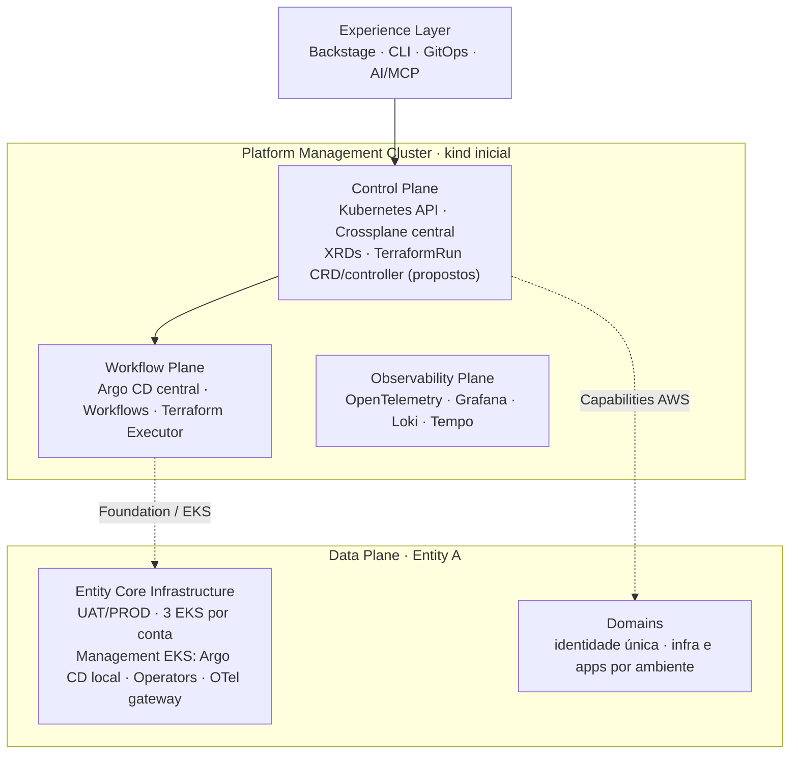

# Platform Engineering POC

> Plataforma **Kubernetes-native** construída em labs incrementais, com governança central e autonomia federada por **Domain**.

**`Kubernetes API` · `Crossplane v2` · `Argo CD` · `Argo Workflows` · `TerraformRun (proposto)` · `GitHub Actions (app separada)` · `OpenTelemetry` · `AWS`**

> [!NOTE]
> **Estado atual:** arquitetura documentada, sem deploy AWS/Kubernetes realizado por esta revisão. As pastas são organizacionais ou exemplos de implementação futura.

> [!NOTE]
> Projeto **pessoal de laboratório**, independente de qualquer iniciativa corporativa. A arquitetura abaixo é **alvo**, não comprovação de recursos implantados.

## 🧭 Navegação

| Página | Conteúdo |
| :--- | :--- |
| [🏗️ Arquitetura](docs/architecture.md) | Modelo, topologia, ownership, contratos e fluxo completo |
| [🗂️ Monorepo](docs/repository-structure.md) | Responsabilidades e localização das configurações |
| [📝 Decisões vigentes](docs/adr/README.md) | ADRs atuais, sem versões contraditórias |
| [🧪 Roteiro prático](docs/learning-roadmap.md) | Fases de laboratório, AWS real e validações |
| [▶️ Lab 01: Hub kind + Traefik](labs/01-platform-management-cluster.md) | Preparar cluster, namespaces, portas e ingress HTTP local |
| [📖 Fundamentos](docs/fundamentos/README.md) | 24 aulas conceituais pt-BR |
| [🤖 Orientações para agentes](AGENTS.md) | Padrões de implementação e segurança |

## 🧱 Visão arquitetural

**Environment é o contexto UAT/PROD associado à conta AWS inteira, não apenas ao Core.** O Data Plane contém **Core Infrastructure compartilhada** e **Domains** de negócio/aplicação. Um Domain pode possuir Capabilities, namespaces e apps em ambos os ambientes. **Domain Bootstrap é uma proposta anterior em reavaliação, não um pré-requisito da POC**. O perfil `standard` e seu gerador permanecem descritos para referência, mas não serão implementados agora. Capabilities continuam entregues por Crossplane central e aplicações por Argo CD local.

## 👥 Personas e experiência da plataforma

| Persona | Responsabilidade | Nível de abstração |
| :--- | :--- | :--- |
| **Platform Team** | Constrói/opera a plataforma, módulos, contratos, guardrails e Golden Paths | Conhece os motores internos |
| **Federated DevOps Team** | Gerencia o lifecycle da **Domain Infrastructure** (Database, ObjectStorage, Messaging) a partir das Capabilities aprovadas | Conhece catálogo, contratos e processos de infraestrutura |
| **Application Team** | Desenvolve código e mantém repositório da aplicação, CI/CD e manifests Kubernetes | Consome **Golden Paths / Starter Kits**, sem precisar entender Crossplane/TerraformStack/Argo internamente |

A infraestrutura do Domain é simulada em **pastas do monorepo**, sob ownership do **DevOps Federado**. Já **código, GitHub Actions e manifests Kubernetes da aplicação** pertencem ao **repositório separado da squad**. O Argo CD local entrega os manifests do repo da aplicação nos EKS autorizados.

**Aplicação mínima de demonstração (preferência: Python + Flask):** o objetivo é validar **a plataforma**, não desenvolver um produto. **Primeiro**, após EKS e Argo CD local, a aplicação serve como **smoke test técnico do Data Plane (Lab 10B)**. **Depois**, com observabilidade e governança consolidadas, estudamos **Developer Experience (Lab 15)** e, **por último**, reaproveitamos a aplicação para provar o Golden Path/integração completa (Lab 16). Não desenvolver Starter Kit completo nem antecipar portal/CI/CD sofisticado para o primeiro teste. Infraestrutura de Domain continua sob DevOps Federado. [ADR-0007](docs/adr/0007-personas-and-developer-experience.md).

## 🧩 Quatro conceitos fundamentais

| Conceito | Papel | Representação inicial |
| :--- | :--- | :--- |
| **Entity** | Organização / responsáveis | Git |
| **Environment** | Conta AWS UAT/PROD, região e perfis | `environment.yaml`, não CRD |
| **Domain** | Identidade lógica, ownership, consumo, infraestrutura e aplicações | Um `domain.yaml` por Domain, não XRD |
| **Capability** | Produto técnico entregue pela plataforma | XRD + Composition + Provider Crossplane |

`ObjectStorage` é a primeira Capability e **`Database` (Aurora PostgreSQL)** vem em seguida; `Messaging` e `ComputeInstance` ficam planejados. Sem MSK inicial ou `CapabilityClaim` genérico.

## 🔐 Quatro camadas de ownership

| Camada | Gestão | Motor |
| :--- | :--- | :--- |
| **Foundation** | Central | Terraform / configuração por Entity e Environment |
| **Entity Core Infrastructure** | Federado propõe; mudanças críticas sob governança | Terraform para EKS |
| **Domain Infrastructure** | Federado / Domain | Argo CD central → Crossplane → AWS |
| **Domain Applications** | Application Team (repo próprio com código **e manifests Kubernetes**) | GitHub Actions → Argo CD local → EKS autorizado |

**Um único monorepo** simula a organização por Entity/Domain. O Crossplane é central, sem cascata, e Argo CD local administra aplicações. A definição das contas e o provisioning de Foundation não dependem de criar `AWSEnvironment` ou Environment Controller próprio nesta fase.

## 🔧 Novas decisões arquiteturais

- **TerraformRun CRD + Controller (propostos):** interface declarativa do Hub para execuções Terraform/OpenTofu via Argo Workflows e Terraform Executor, com `plan`, gates, `apply` e status; sem `apply` contínuo a cada reconciliação. [ADR-0006](docs/adr/0006-terraformrun-and-application-ci.md).
- **Domain Applications:** código e workflows CI/CD **GitHub Actions em outro repositório de aplicação de teste**, ainda não fornecido; deploy GitOps nos EKS via Argo CD local.
- **Management EKS:** Argo CD local, Operators **a escolher** e OpenTelemetry Collector/gateway para logs e traces; backend central com **Grafana + Loki + Tempo**. Estratégia de métricas/Prometheus em validação.
- **Ownership:** Foundation → Entity Core Infrastructure → Domain Infrastructure → Domain Applications.
- **Domain Bootstrap:** documentação preservada, mas **adiado e em reavaliação**, sem implementação neste ciclo.

[Decisão de personas e Golden Paths](docs/adr/0007-personas-and-developer-experience.md)

## 🧰 Domain Bootstrap

**Proposta anterior (atualmente em reavaliação, sem implementação imediata):** ao criar um Domain, a plataforma executaria o **Domain Bootstrap** como fluxo padrão: o perfil versionado define a estrutura e os recursos iniciais, considerando os Environments escolhidos. Não existe um Bootstrap independente obrigatório por Environment. O gerador produz os manifests de Capabilities (`infrastructure/`) e de namespaces/policies (`applications/`) para revisão em PR. O **Argo CD central** aplica os CRs de Capability, o **Crossplane** entrega AWS e o **Argo CD local** configura Kubernetes. A conclusão é verificada para o Domain, com detalhamento por Environment; criar em UAT não seleciona PROD automaticamente. [Detalhamento](docs/architecture.md#6-domain-bootstrap-criação-padronizada-do-domain).

## ☁️ Estratégia AWS

Primeiro Hub `kind` com [Lab 01 executável](labs/01-platform-management-cluster.md), depois Crossplane no Hub; em seguida preparar a **conta UAT existente** e a autenticação AWS, ainda a definir, para `ObjectStorage` real e `Database` com **Amazon Aurora PostgreSQL**. Depois contas UAT/PROD distintas, Terraform Foundation/Core, um EKS Auto Mode de cada vez e GitOps local. A criação automatizada de contas é evolução opcional, justificada em lab futuro.

> [!IMPORTANT]
> Executar AWS somente com conta/região verificadas via STS, IAM mínimo, custo, autorização explícita e plano de cleanup. Não publicar credenciais, kubeconfigs ou Terraform state. Aprovar a documentação **não** autoriza `apply`/`destroy`.

[Arquitetura completa](docs/architecture.md) · [Roteiro](docs/learning-roadmap.md)
