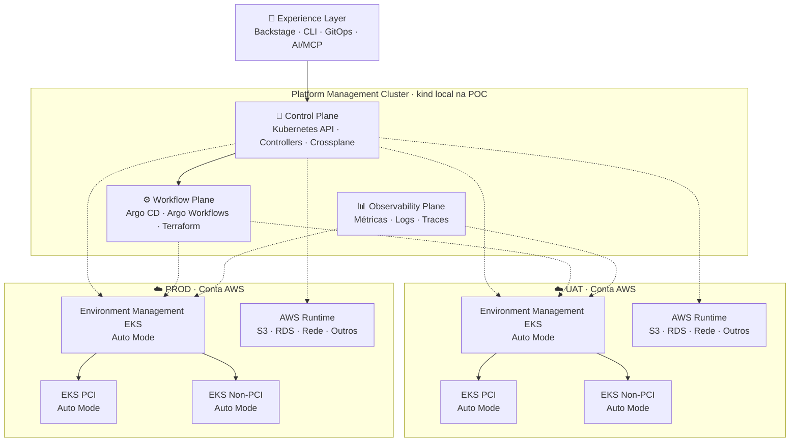

# Platform Engineering POC

> Uma plataforma **Kubernetes-native**, construída passo a passo para estudar contratos declarativos, reconciliação, self-service e provisionamento real na AWS.

**`Kubernetes API` · `Crossplane` · `Argo Workflows` · `Terraform` · `Argo CD` · `AWS`**

> [!NOTE]
> **Estado atual:** arquitetura e materiais conceituais documentados; sem deploy dos componentes da POC. Os ambientes AWS não foram provisionados por este repositório.

## 🧭 Comece por aqui

| Caminho | O que você encontra |
| :--- | :--- |
| 📖 **[Fundamentos](docs/fundamentos/README.md)** | 24 artigos conceituais em português: Platform as a Product, Golden Paths, IDP, contratos e reconciliação |
| 🏗️ **[Arquitetura](docs/architecture.md)** | Camadas, responsabilidades e fluxo entre Kubernetes API, Crossplane e AWS |
| 🧪 **[Roteiro prático](docs/learning-roadmap.md)** | Implementação progressiva, da preparação local até AWS real |
| 📝 **[Decisões arquiteturais](docs/adr/README.md)** | ADRs e justificativas das escolhas técnicas |
| 🗂️ **[Estrutura do repositório](docs/repository-structure.md)** | Onde ficará cada componente |
| 🤖 **[Orientações para agentes](AGENTS.md)** | Convenções, segurança e critérios de qualidade |

## 🧱 Arquitetura em uma visão

**Uma API, diferentes reconciliadores.** O Kubernetes API Server recebe os recursos. O **Environment Controller** cuida de `AWSEnvironment`; o **Crossplane** implementa `Domain` e as Capabilities especializadas. Argo Workflows coordena processos longos e aprovações.

**Leitura do diagrama:** linhas contínuas indicam relações lógicas dentro da arquitetura; linhas tracejadas representam integrações de gerenciamento e observabilidade, **não conexões de rede ou permissões já configuradas**. O Management EKS de cada ambiente gerencia seus clusters de workloads apenas quando as regras de segurança permitirem.

| Ambiente | Cluster de gerenciamento | Clusters de workloads | Recursos AWS |
| :--- | :--- | :--- | :--- |
| **UAT** | Environment Management EKS (Auto Mode) | EKS PCI · EKS Non-PCI | AWS Runtime |
| **PROD** | Environment Management EKS (Auto Mode) | EKS PCI · EKS Non-PCI | AWS Runtime |

[Detalhes e limites da arquitetura](docs/architecture.md) · [ADR de reconciliação](docs/adr/0009-crossplane-e-reconciliacao.md)

## 🧭 Quatro camadas de ownership

| Camada | Owner | Recursos e motor |
| :--- | :--- | :--- |
| **Foundation** | Plataforma central | Conta, landing zone, VPC, IAM · Terraform |
| **Entity Core Infrastructure** | DevOps federado, com governança central | Management EKS, EKS PCI e EKS Non-PCI · Terraform |
| **Domain Infrastructure** | DevOps federado | Capabilities AWS · Crossplane central |
| **Applications** | Times locais | Workloads Kubernetes · Argo CD local |

**Um monorepo** representa essas fronteiras por pastas. O Argo CD **central** sincronizará os contratos de infraestrutura; o Argo CD **local** cuidará das aplicações. Não haverá Crossplane em cascata nem MSK inicial. [Entenda as decisões e o fluxo completo](docs/architecture.md) · [ADR-0012](docs/adr/0012-federated-ownership-and-gitops.md).

## 🛤️ Jornada da POC

| Etapa | Experiência |
| :--- | :--- |
| **01 · Compreender** | Estudar os [fundamentos](docs/fundamentos/README.md) e as decisões de arquitetura |
| **02 · Preparar** | Montar o Platform Management Cluster em `kind` e configurar acesso seguro à AWS |
| **03 · Entregar** | Implantar Crossplane e provisionar `ObjectStorage` **real** por XRD + Composition |
| **04 · Evoluir** | Incorporar GitOps, `Domain`, `AWSEnvironment` e workflows |
| **05 · Expandir** | Separar UAT e PROD em contas AWS e, gradualmente, usar EKS Auto Mode |
| **06 · Automatizar** | Evoluir para criação de contas AWS pelo lifecycle de `AWSEnvironment` |

[Acompanhar fases, evidências e critérios de saída](docs/learning-roadmap.md)

## 🧩 Contratos da plataforma

| Família | Contrato | Implementação prevista |
| :--- | :--- | :--- |
| **Environment** | `AWSEnvironment` | CRD nativo + Environment Controller |
| **Domain** | `Domain` | XRD + Crossplane Composition |
| **Capabilities** | `Database`, `ObjectStorage`, `ComputeInstance`, `Messaging` | XRDs + Crossplane Compositions / Providers |

Cada `AWSEnvironment` representa uma conta AWS. Vários Domains podem pertencer a um ambiente. **Capability** é a família lógica, não um recurso genérico `CapabilityClaim`.

## ☁️ Estratégia AWS

1. **Conta existente:** provisionar Capabilities reais numa conta autenticada.
2. **UAT e PROD:** trabalhar com duas contas preexistentes e isoladas.
3. **Criação de contas:** automatizar a fundação e o lifecycle futuramente.

O **Hub permanece inicialmente em `kind`**. Os EKS dos Data Planes terão **Amazon EKS Auto Mode** como padrão, sujeitos a validação técnica e financeira.

> [!IMPORTANT]
> Recursos reais na AWS exigem confirmação de conta/região, privilégios mínimos, avaliação de custos, autorização de execução e estratégia de limpeza. Não versionar credenciais, kubeconfigs ou Terraform state. Documentar uma arquitetura **não autoriza** executar `apply` ou `destroy`.

---

Laboratório pessoal · Documentação em português brasileiro · [ADR-0010 — AWS real](docs/adr/0010-aws-real-e-ambientes.md) · [ADR-0011 — EKS Auto Mode](docs/adr/0011-eks-auto-mode.md)
