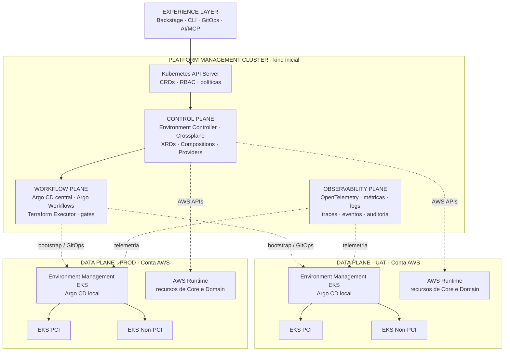
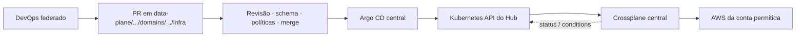

# 🏗️ Arquitetura da Platform Engineering POC

[← Página inicial](../README.md) · [Decisões arquiteturais](adr/README.md) · [Estrutura do monorepo](repository-structure.md) · [Roteiro prático](learning-roadmap.md)

> [!NOTE]
> **Estado: arquitetura-alvo aprovada para estudo, ainda não implementada.** Este documento é a referência consolidada da POC. Diretórios e fluxos abaixo são propostas de implementação, não comprovação de recursos implantados. Nenhuma alteração AWS está autorizada por esta documentação.

## 1. Visão e princípios

Construir uma **Internal Developer Platform Kubernetes-native**, com contratos declarativos, governança central e autonomia federada para infraestruturas de Domain e aplicações. O laboratório utiliza **um único monorepo**: suas pastas representam as fronteiras que, numa plataforma real, poderiam ser mantidas por equipes ou repositórios distintos.

Os princípios são:

1. **Uma API de plataforma:** o Kubernetes API Server central expõe contratos tipados e estados operacionais; Crossplane e controllers são reconciliadores, não APIs paralelas.
2. **Git como fonte do estado desejado:** alterações persistentes preferencialmente por PR; GitOps sincroniza manifests, enquanto `status`, eventos, logs e Terraform state não são versionados.
3. **Governança central, consumo federado:** Foundation e contratos/políticas globais são da equipe central; equipes federadas alteram somente os escopos de Core/Domain autorizados; aplicações têm entrega local.
4. **Ownership explícito:** um recurso externo tem um único reconciliador responsável. Terraform mantém Foundation e EKS; Crossplane mantém as Capabilities AWS atribuídas a ele.
5. **Execução progressiva e segura:** Hub em `kind`, primeira Capability em conta AWS existente, depois UAT/PROD em contas distintas, EKS Auto Mode incremental e criação automatizada de contas somente no futuro.
6. **A configuração do repositório não substitui autorização:** pastas, namespaces e CODEOWNERS não equivalem isoladamente a controles de acesso AWS/Kubernetes.

## 2. Planos da plataforma e topologia

Os planos são **responsabilidades lógicas**, não uma regra de um cluster por plano. O **Platform Management Cluster** (Hub, inicialmente `kind`) hospeda Control, Workflow e Observability. Cada ambiente AWS possui seu **Environment Management EKS**, **EKS PCI** e **EKS Non-PCI**, com **Amazon EKS Auto Mode** como padrão sujeito a validação.



**Como ler:** setas tracejadas representam dependências e interações lógicas, não rotas VPC nem permissões já concedidas. Os vínculos do Management EKS aos clusters PCI/Non-PCI indicam gestão pretendida, **condicionada a aprovação de isolamento administrativo PCI**. Não pressupõem que um Argo CD tenha acesso irrestrito a ambos. O modelo é reproduzível para novas entidades, mas a POC começa com **uma entidade lógica fictícia**, dois ambientes-alvo (UAT/PROD) e uma conta real preexistente nos primeiros labs; o diagrama não implica contas/clusters já criados.

### Responsabilidades de cada plano

| Plano | Componentes e objetos | Responsabilidade |
| :--- | :--- | :--- |
| **Experience Layer** | Backstage, CLI, PR GitOps, agentes AI/MCP | Descoberta e solicitação; não exige Backstage como único ponto de entrada |
| **Control Plane** | Kubernetes API, `AWSEnvironment`, `Domain`, XRDs de Capabilities, Environment Controller, Crossplane Core, Compositions/Providers, RBAC/políticas | Contratos, validação, reconciliação e `status.conditions` |
| **Workflow Plane** | Argo CD central, Argo Workflows, Terraform Executor, gates | Sincronização de contratos e execução/auditoria de processos de longa duração |
| **Observability Plane** | OTel, logs, métricas, traces, eventos e auditoria | Correlação de solicitações, reconciliação e falhas; backends ainda a definir |
| **Data Plane** | Contas AWS UAT/PROD, três EKS por conta, AWS Runtime | Execução de workloads e materialização de recursos externos |

**Hub-and-Spoke** descreve a topologia de gerenciamento, não substitui os planos nem define automaticamente uma topologia de rede AWS.

## 3. Quatro camadas de ownership da infraestrutura

Essas quatro camadas descrevem **escopo de gestão e organização Git**, não são novos Kubernetes clusters nem substituem os planos acima. `Entity Core Infrastructure` inclui recursos comuns à entidade mesmo quando nenhum Domain individual é seu proprietário.

| Camada | Owner | Escopo | Provisionamento / reconciliação |
| :--- | :--- | :--- | :--- |
| **1. Foundation** | **Plataforma central** | Conta AWS, landing zone, conectividade, VPC, IAM e segurança base | Terraform orquestrado no Workflow Plane; lifecycle via `AWSEnvironment` posteriormente |
| **2. Entity Core Infrastructure** | **DevOps federado dentro dos contratos permitidos**, com políticas/aprovação central | Três EKS por ambiente e capacidades compartilhadas da entidade | Terraform para EKS; Crossplane central para Capabilities AWS compartilhadas que venham a ser necessárias |
| **3. Domain Infrastructure** | **DevOps federado / responsável pelo Domain** | Recursos de infraestrutura exclusivos de um Domain | Crossplane **central** via XRDs, Compositions e AWS Providers |
| **4. Applications** | **Time de aplicação / operação local** | Código, Deployment, Service, ConfigMap, configuração e release de workloads | Argo CD **local** do Environment Management EKS, sujeito às restrições PCI |

**MSK não faz parte do escopo inicial.** Qualquer recurso compartilhado futuro deve ter owner, consumidores e política de exclusão próprios; não deve pertencer artificialmente ao primeiro Domain que o consome.

**Separação de responsabilidades:** a equipe central controla módulos, plataformas e políticas, inclusive Foundation. A equipe federada pode propor alterações via Git e administrar o estado desejado que seu contrato autoriza. Alterar YAML de um EKS **não concede** autorização automática para reprovisionar ou destruir clusters. Recursos estruturais exigem gate de acordo com risco, custo e fronteira de segurança.

## 4. Monorepo: representação das fronteiras

**Decisão para a POC:** um GitHub monorepo. Não criar repositórios reais `entity-foundation`, `entity-core-infra` ou `domain-*-infra` nesta fase. Diretórios representam essas fronteiras, enquanto `CODEOWNERS`, validações e aplicações GitOps por caminho demonstram controles de governança. O desenho a seguir é **proposto**, não a árvore atualmente criada:

```text
platform-engineering-poc/
├── platform/hub/                  # bootstrap do Hub local
├── control-plane/                 # contratos, Crossplane e controllers
├── workflow-plane/                # Argo CD central, Argo Workflows, Terraform
├── observability-plane/
├── foundation/                    # ownership central
│   ├── modules/                   # fundação Terraform reutilizável
│   └── config/                    # variações por entidade e ambiente
│       └── entity-a/
│           ├── uat/
│           └── prod/
├── data-plane/
│   └── entity-a/                  # segmentação lógica da entidade
│       ├── uat/
│       │   ├── core-infra/        # 3 EKS e recursos comuns
│       │   ├── domains/
│       │   │   └── domain-a/
│       │   │       └── infra/     # CRs de Domain/Capabilities
│       │   └── applications/      # manifests/apps locais
│       └── prod/
│           ├── core-infra/
│           ├── domains/
│           └── applications/
├── docs/                          # conceitos, arquitetura, ADRs
├── labs/                          # exercícios por fase
└── tests/
```

**Compatibilidade com o repositório atual:** os diretórios existentes `data-plane/uat/` e `data-plane/prod/` com `management-eks/`, `eks-pci/`, `eks-non-pci/` e `aws-runtime/` continuam como marcadores iniciais. A migração para `data-plane/entity-a/{uat,prod}/` só acontecerá quando surgirem os primeiros manifests; **não renomear ou duplicar diretórios nesta revisão documental**. O exemplo `entity-a` é uma entidade fictícia do laboratório, sem associação corporativa ou geográfica.

A pasta **`foundation/modules/`** representa código reutilizável; **`foundation/config/`** representa valores de entrada por entidade/ambiente. O Terraform **state fica fora do Git**, isolado por conta/ambiente/componente. É possível evoluir a configuração para manifests `AWSEnvironment`, mas o contrato exato e a migração dos YAMLs serão definidos no lab correspondente.

### Política de contribuição

- **Foundation:** alterações sob aprovação da equipe central; um DevOps federado pode propor PR, mas não alterar o ownership.
- **Core:** DevOps federado propõe alterações em caminhos da entidade; mudanças sensíveis passam por políticas, revisão e gates centrais.
- **Domain:** o federado mantém as declarações do Domain, respeitando schema, conta/ambiente, quota e permissões.
- **Applications:** configuração de deploy das aplicações gerenciada pelo time local via Argo CD local.
- Em monorepo, **`CODEOWNERS` só impõe revisão se combinado com as proteções de branch/rulesets apropriadas**; não substitui IAM/RBAC ou política de admissão.

## 5. Contratos da Kubernetes API e suas responsabilidades

O contrato público usa **o mesmo Kubernetes API Server do Hub**, mesmo quando reconciliadores diferentes implementam recursos distintos.

| Recurso / família | Mecanismo | Owner do reconciliador | Resultado esperado |
| :--- | :--- | :--- | :--- |
| `AWSEnvironment` | CRD nativo | Environment Controller próprio (Go/controller-runtime planejado) | Adotar/criar ambiente, coordenar Foundation e EKS, publicar `status.conditions` |
| `Domain` | XRD Crossplane + Composition | Crossplane central | Registrar o escopo lógico e produzir configurações permitidas do Domain |
| `ObjectStorage`, `Database`, `ComputeInstance`, `Messaging` | XRDs tipados, Compositions, Providers | Crossplane central | Recursos AWS sob ownership do Domain ou da entidade |
| Workloads Kubernetes | Manifests Kubernetes | Argo CD local | Aplicações e configuração do cluster de destino |

`Capability` é uma **família lógica**, não um `CapabilityClaim` genérico. Referências como `environmentRef` e `domainRef` são **contratos planejados**, não integridade relacional garantida nativamente: validar identidade, namespace, destino, status da conta, permissões e ciclo de vida antes de admitir mudanças.

**Decisão para `Domain`:** preservar contrato central; **preferir Argo CD local como aplicador de namespace, quota e políticas Kubernetes nos EKS remotos**, evitando dois controladores como owners do mesmo objeto. Ainda é necessário validar o mecanismo de entrega do estado desejado do Hub/Git para o Argo local e a devolução de status. A Composition no Hub **não cria automaticamente namespaces em clusters remotos**.

## 6. GitOps e reconciliação: fluxos separados

### 6.1 Domain Infrastructure — mudança feita pelo federado



A sincronização do Git **é realizada pelo Argo CD**, não pelo Crossplane. O Crossplane observa o CR na Kubernetes API e reconcilia o recurso AWS. O DevOps federado pode fazer alterações autorizadas no Git de seu Domain, sem operar o Crossplane. O status operacional deve ser consultado na API/observabilidade, não gravado como `status` no Git.

### 6.2 Applications — reconciliação local

```text
data-plane/.../applications/ (Git, após PR/merge)
    → Argo CD no Environment Management EKS
    → EKS PCI ou EKS Non-PCI permitido
    → Deployments / Services / ConfigMaps / aplicações
```

O Argo CD local opera declarativamente sobre recursos Kubernetes **dos clusters autorizados**. A instalação local não implica acesso cruzado irrestrito a PCI; se necessário, teremos instâncias/credenciais segregadas por fronteira de segurança. O Crossplane central **não** gerencia Deployments das aplicações.

### 6.3 Foundation e Entity Core — workflows controlados

```text
foundation/config/ ou data-plane/.../core-infra/ (Git)
    → revisão e validações centrais/federadas
    → workflow autorizado (Argo Workflows)
    → Terraform Executor: plan → aprovação → apply → verificação
    → conta AWS / EKS → status e evidências
```

**Argo CD não é executor Terraform.** O `AWSEnvironment` passa a ser a interface de ciclo de vida quando seu controller for implementado, coordenando a execução dos mesmos módulos. Inicialmente os labs podem invocar Terraform de maneira controlada antes da existência desse controller. Mudanças de Foundation e EKS exigem aprovações explícitas por operação e isolamento de state.

### 6.4 Recursos compartilhados da entidade

Uma Capability compartilhada reside em `core-infra/` e é reconciliada pelo **Crossplane central** quando sua classe for delegada a esse motor. Seus consumidores podem estar em múltiplos Domains, mas **um Domain não pode excluir o recurso compartilhado por remover suas próprias declarações**. A escolha do motor é por recurso, não apenas pela pasta Git.

## 7. Modelo de segurança, identidade e isolamento

| Fronteira | Mecanismos | O que não garantem sozinhos |
| :--- | :--- | :--- |
| Git | CODEOWNERS, PRs, branch protection/rulesets, validação de paths | IAM AWS ou isolamento entre contas |
| Kubernetes central | Namespaces, RBAC, políticas de admissão, validação de referências | Restringir automaticamente credenciais do Provider |
| AWS | IAM Roles por conta/ambiente, STS, privilégio mínimo, perfis explícitos | Evitar selecionar a role errada sem validação de contrato |
| Execução | State Terraform separado, gates, trilha de auditoria, controle de concorrência | Recuperação de falhas sem projeto de idempotência |
| PCI | Credenciais, destinos e fronteiras administrativas avaliadas por cluster | Conformidade automática apenas por separar EKS |

O Crossplane central utiliza **configurações de autenticação por escopo de conta/ambiente**, de acordo com o Provider AWS efetivamente selecionado; o contrato `Domain` não deve permitir que um consumidor escolha arbitrariamente uma credencial mais privilegiada. O teste de um segundo Domain e de uma conta distinta deve demonstrar tentativas de acesso indevido **negadas**.

**Credenciais no Hub `kind`:** usar credenciais temporárias ou federação apropriada, sem presumir IRSA ou EKS Pod Identity. Confirmar via AWS STS identidade e região antes de executar um lab real.

## 8. Exclusão, drift e recuperação

- **Conta AWS / Foundation:** remoção de CR, pasta ou branch **nunca** destrói conta automaticamente; descomissionamento é processo separado sob owner central.
- **EKS / Entity Core:** executar destroy somente com aprovação explícita, análise de dependências (incluindo Domains e apps), backup quando necessário e plano de recuperação.
- **Capabilities do Domain:** definir previamente política de exclusão/retenção, `managementPolicies`/`deletionPolicy` compatíveis com o Provider e comportamento de limpeza. Testar primeiro com `ObjectStorage` descartável e vazio.
- **Recursos compartilhados:** owner e dependentes explícitos; a exclusão de um único Domain não remove a infraestrutura de uso comum.
- **Finalizers:** servem para coordenar limpeza antes da exclusão do objeto; **não constituem aprovação humana**.
- **Drift:** Argo CD reconcilia manifests declarativos Kubernetes; Crossplane reconcilia os recursos AWS que administra; Terraform só atua quando seu ciclo de execução/plan é acionado, não oferece reconciliação contínua automática por si só.
- **Falha do Hub:** workloads existentes podem continuar executando; novas mudanças ou correções Crossplane ficam pendentes, e o Argo CD local pode continuar operando enquanto permanecer autônomo e conectado ao Git e aos clusters autorizados.

## 9. Sequência de nascimento de uma entidade e ordem dos labs

### Sequência lógica de uma entidade completa

1. **Foundation:** equipe central cria ou adota contas AWS, landing zone, rede e IAM base.
2. **Entity Core:** workflow provisiona Management EKS, EKS PCI, EKS Non-PCI; adiciona recursos comuns que forem realmente necessários.
3. **GitOps local:** implanta/configura Argo CD no Management EKS e autorizações dos clusters de workload.
4. **Domain:** registra o contrato central, relações, owner, escopo Git e parâmetros autorizados.
5. **Domain Infra:** DevOps federado altera CRs no monorepo, Argo CD central sincroniza e Crossplane provisiona recursos AWS.
6. **Applications:** Argo CD local implanta workloads e configurações em PCI/Non-PCI autorizados.

### Ordem pedagógica da POC (diferente do lifecycle completo)

1. **Baseline e Hub `kind`** com testes e documentação.
2. **Crossplane e primeira Capability `ObjectStorage` na AWS real** numa conta existente autorizada.
3. **Argo CD central + dois Domains simulados**, demonstrando PR, reconciliação, RBAC e isolamento.
4. **Terraform / Argo Workflows / `AWSEnvironment`** inicialmente usando conta existente e fundação controlada.
5. **Entity Core + EKS Auto Mode** criado um cluster de cada vez, após validação de custo e requisitos.
6. **Argo CD local e workloads**, depois ambientes UAT/PROD em contas reais distintas.
7. **Automação de criação de contas** apenas na etapa avançada.

A ordem pedagógica **não significa** que possamos criar um EKS sem Foundation, ou que a automação de contas deva existir antes da primeira Capability. É uma forma de construir e observar o sistema por fatias verticais.

## 10. Decisões fechadas e pontos de validação

**Definido nesta baseline:**

- Um monorepo; pastas simulam equipes/repositórios federados.
- **Foundation → Entity Core Infrastructure → Domain Infrastructure → Applications** como fronteiras de ownership.
- Foundation central com módulos Terraform compartilhados e configuração por entidade/ambiente.
- Crossplane **único e central** inicialmente, sem Crossplane em cascata.
- **Argo CD central** para sincronizar CRs de infraestrutura; **Argo CD local** para aplicações e configuração Kubernetes.
- EKS da Entity Core via **Terraform**; Capabilities de Domain e eventuais Capabilities compartilhadas via **Crossplane central**.
- Contratos `AWSEnvironment` CRD/controller e `Domain`/Capabilities XRD/Compositions.
- Sem MSK no escopo inicial. Hub local `kind`, AWS real autorizada, EKS Auto Mode como padrão.

**A validar ao implementar:** schema/versionamento dos CRs, caminhos e formato YAML exatos, bootstrap GitOps, permissões por paths, associação automática de Domain/Environment e credenciais, mecanismo de propagação para Argo CD local, segregação PCI, `status.conditions`, backend de observabilidade, custo e política de exclusão de cada produto.

**ADRs relacionados:** [0001 — API](adr/0001-kubernetes-native-platform-api.md), [0008 — Monorepo](adr/0008-monorepo-and-learning.md), [0009 — Crossplane](adr/0009-crossplane-e-reconciliacao.md), [0010 — AWS real](adr/0010-aws-real-e-ambientes.md), [0011 — EKS Auto Mode](adr/0011-eks-auto-mode.md) e [0012 — Ownership federado e GitOps](adr/0012-federated-ownership-and-gitops.md).

---

[← Página inicial](../README.md) · [ADRs](adr/README.md) · [Estrutura](repository-structure.md) · [Roteiro prático](learning-roadmap.md)
