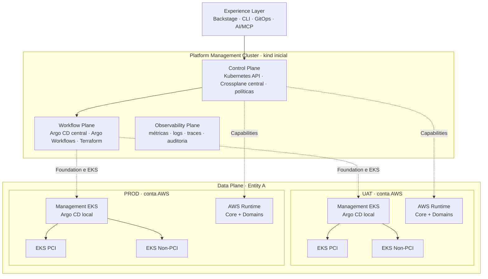
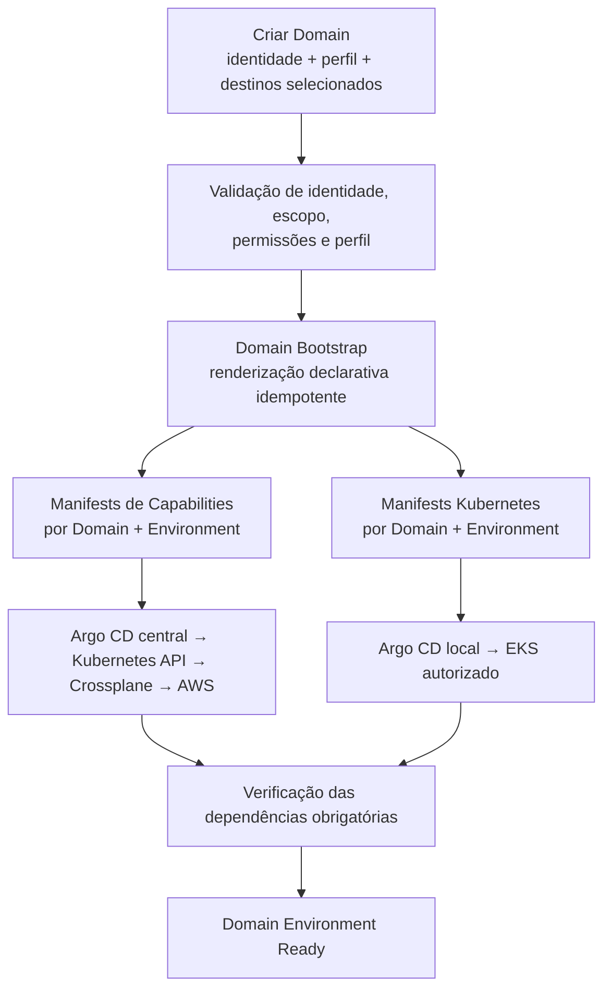
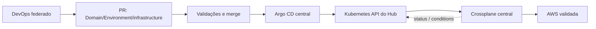

# 🏗️ Arquitetura da Platform Engineering POC

[← Início](../README.md) · [Decisões atuais](adr/README.md) · [Monorepo](repository-structure.md) · [Roadmap](learning-roadmap.md)

> [!NOTE]
> **Arquitetura-alvo, não implementada.** Um monorepo de laboratório simula ownership e autonomia federada. Nenhuma operação AWS está autorizada por este documento. Nomes de entidades e Domains são fictícios.

## 1. Modelo arquitetural

A POC demonstra uma plataforma **Kubernetes-native** de governança central e consumo federado. Existem duas dimensões distintas:

- **Planos:** Experience Layer, Control Plane, Workflow Plane, Observability Plane e Data Plane. Os três planos técnicos centrais coexistem no **Platform Management Cluster**, inicialmente `kind`.
- **Quatro camadas de ownership:** **Foundation → Entity Core Infrastructure → Domain Infrastructure → Applications**. Elas classificam responsabilidade de mudança e lifecycle, **não** representam planos ou clusters adicionais.

A **Entity** reúne a operação organizacional. Um **Environment** (UAT/PROD) é o contexto de uma conta AWS. O **Domain** é a unidade lógica de negócio, consumo, ownership e governança: possui Capabilities e aplicações em um ou mais Environments. **Capability** é o produto técnico provisionável, como `ObjectStorage`.

**Environment não é sinônimo de Core Infrastructure**: o ambiente é a conta toda, incluindo Core e os recursos dos Domains.

## 2. Visão geral



Linhas tracejadas representam integração lógica, **não redes AWS nem permissões concedidas**. A arquitetura permite várias entidades. Cada entidade-alvo contém UAT e PROD em **contas AWS distintas**, cada uma com **Management EKS, EKS PCI, EKS Non-PCI** e serviços AWS. Na representação de **uma entidade** são sete clusters no total (Hub + 2×3), não um limite global. EKS Auto Mode é a preferência para EKS reais, **sob validação de custos, operadores e PCI**; criar um cluster de cada vez. O Argo CD local pode exigir segregação de instâncias/credenciais para PCI.

| Plano | Responsabilidade |
| :--- | :--- |
| **Experience Layer** | Consumidores independentes: Backstage, CLI, PR GitOps, AI/MCP; Backstage não é gateway obrigatório |
| **Control Plane** | Kubernetes API Server central, XRDs/Compositions/Providers de Capabilities, Crossplane e políticas |
| **Workflow Plane** | Argo CD central, Argo Workflows, Terraform Executor, aprovações |
| **Observability Plane** | Métricas, logs, traces, status, eventos e auditoria |
| **Data Plane** | Contas AWS das Entities, Core compartilhado, Domains, workloads e Argo CD local |

## 3. Quatro conceitos e seus contratos

| Conceito | Definição | Implementação **inicial** |
| :--- | :--- | :--- |
| **Entity** | Identidade organizacional que contém Environments e Domains | Organização declarativa no Git |
| **Environment** | Ambiente UAT/PROD da Entity associado a conta AWS, região e perfis | Registro `environment.yaml` versionado/validado, **não CRD** |
| **Domain** | Unidade lógica de negócio que possui aplicações, namespaces, Capabilities, owners, padrões e políticas | Registro **único** `domain.yaml` por Domain, **não XRD** |
| **Capability** | Produto técnico consumível, com tipo, schema, lifecycle e status próprios | **Crossplane XRD + Composition + Provider** por produto |

A mesma identidade de Domain pode ter recursos diferentes em UAT e PROD. Um bucket, banco ou aplicação pertence ao par **Domain + Environment**. O namespace é a materialização do Domain em um cluster, não sua definição. O Core pertence ao Environment, nunca ao lifecycle de um Domain específico. **MSK está fora do escopo inicial**.

Exemplo **ilustrativo** de Environment, sob gestão da Foundation central:

```yaml
# foundation/config/entity-a/uat/environment.yaml
entity: entity-a
environment: uat
aws:
  accountId: "111122223333" # fictício
  region: us-east-1
foundation:
  profile: standard
core:
  profile: eks-standard
```

Exemplo **ilustrativo** de Domain (identidade única):

```yaml
# data-plane/entity-a/domains/payments/domain.yaml
domain: payments
entity: entity-a
owners: [team-payments]
environments: [uat, prod]
policies:
  profile: standard
```

Esses YAMLs **não são manifests Kubernetes** e não devem ser sincronizados diretamente pelo Argo CD central. Inicialmente são lidos por validações e ferramentas de workflow. A vinculação confiável **Entity + Environment + Domain → conta/IAM/namespace** precisa ser construída e testada: consumidores não podem escolher credenciais AWS arbitrárias.

**`ObjectStorage` e `Database` são as duas primeiras Capabilities da POC**, nessa ordem. A primeira implementação de `Database` usará **Amazon Aurora PostgreSQL** (cluster Aurora), sem assumir que uma definição lógica de `Database` tenha de se limitar a Aurora em versões futuras; `Messaging` e `ComputeInstance` ficam no roadmap. **Não criar `CapabilityClaim` genérico.** Na **criação do Domain**, o **Domain Bootstrap** aplica o padrão inicial definido pelo perfil versionado e gera as Capabilities e configurações previstas para os Environments selecionados, usando os contratos existentes; Capabilities adicionais e Deployments de aplicações continuam solicitações independentes. Ver [Domain Bootstrap](#6-domain-bootstrap-criação-padronizada-do-domain).

## 4. Quatro camadas de ownership

| Camada | Quem solicita | Quem controla execução e lifecycle | Recursos / motor |
| :--- | :--- | :--- | :--- |
| **Foundation** | Plataforma central; federado pode propor PR | Plataforma central | Conta, landing zone, rede, IAM; **Terraform** e configurações por Entity/Environment |
| **Entity Core Infrastructure** | DevOps federado nos limites autorizados | Plataforma governa componentes críticos | Três EKS e recursos comuns por Environment; **Terraform para EKS** |
| **Domain Infrastructure** | DevOps federado / Domain | Crossplane central sob políticas | Capabilities de Domain/Environment via **XRDs** |
| **Applications** | Time de aplicação | Argo CD local com destinos restritos | Namespace, policies e workloads Kubernetes |

Um recurso externo tem **um único owner de reconciliação**. Terraform administra Foundation/EKS; Crossplane as Capabilities que lhe forem atribuídas. Core futuro pode conter Capability compartilhada, desde que tenha owner explícito e não seja excluída pela remoção de um Domain consumidor.

## 5. Organização do monorepo

```text
platform-engineering-poc/
├── platform/hub/                        # bootstrap kind
├── control-plane/                       # Crossplane, Capabilities e políticas
├── workflow-plane/                      # GitOps central, Workflows, Terraform
├── observability-plane/
├── foundation/                          # central, a criar no lab
│   ├── modules/
│   └── config/entity-a/
│       ├── uat/environment.yaml
│       └── prod/environment.yaml
├── data-plane/
│   └── entity-a/
│       ├── core-infrastructure/         # compartilhado por ambiente
│       │   ├── uat/
│       │   │   ├── management-eks/
│       │   │   ├── eks-pci/
│       │   │   └── eks-non-pci/
│       │   └── prod/
│       │       ├── management-eks/
│       │       ├── eks-pci/
│       │       └── eks-non-pci/
│       └── domains/
│           ├── payments/
│           │   ├── domain.yaml          # identidade única
│           │   ├── uat/
│           │   │   ├── infrastructure/  # XRs de Capability
│           │   │   └── applications/    # Argo CD local
│           │   └── prod/
│           │       ├── infrastructure/
│           │       └── applications/
│           └── orders/
├── docs/
├── labs/
└── tests/
```

**Esta é a árvore-alvo; o primeiro lab cria somente a configuração executável do Hub `kind` e um template declarativo de conta UAT.** Diretórios de Domain/Foundation serão adicionados somente com conteúdo real dos labs. Os README de infraestrutura preexistentes podem permanecer como documentação temporária até a implementação; não são fontes de configuração runtime. A [estrutura](repository-structure.md) especifica essa transição.

O monorepo demonstra autonomia via PR, revisão de paths e eventualmente CODEOWNERS. **CODEOWNERS sem regras de proteção não basta;** também são necessários RBAC Kubernetes, admission, IAM por conta e AppProjects Argo CD. Terraform state fica fora do Git.


## 6. Domain Bootstrap: criação padronizada do Domain

O **Domain é uma identidade lógica única na Entity**. **Quando ele é criado**, a plataforma usa o **Domain Bootstrap** como fluxo padrão de inicialização: escolhe e valida um perfil versionado, gera sua estrutura e as declarações dos recursos previstos nesse perfil. O processo é iniciado **pela criação do Domain**, não como uma obrigação de executar um Bootstrap independente para cada Environment. O Domain pode solicitar Capabilities adicionais depois. **Cadastrar um Domain não equivale a concluir seu Bootstrap**.

### O que o perfil `standard` cria (exemplo da POC)

| Recurso inicial definido pelo perfil | Motor de entrega | Destino / ownership |
| :--- | :--- | :--- |
| `Database` | Manifest de Capability → Argo CD **central** → Crossplane → AWS | Domain, no Environment |
| `ObjectStorage` | Manifest de Capability → Argo CD **central** → Crossplane → AWS | Domain, no Environment |
| Namespace(s) nos destinos Kubernetes permitidos | Manifest Kubernetes → Argo CD **local** | Domain, por cluster/destino |
| Quotas, políticas de rede/segurança, permissões e labels/tags aplicáveis | GitOps local para Kubernetes; políticas de Capability para AWS | Governança da plataforma, instanciada para Domain |

**Nota de fases:** o perfil `standard` de referência cria banco, bucket, namespace e políticas como padrão de nascimento do Domain. `ObjectStorage` continua sendo o primeiro **produto técnico implementado** no lab; `Database` será o segundo, com **Aurora PostgreSQL**, conforme validação de rede, custo, permissões e estratégia de remoção. Um perfil de laboratório reduzido pode demonstrar o mecanismo antes disso. **Não declarar um Domain com perfil `standard` como `Ready` enquanto os recursos previstos por esse perfil não estiverem provisionados e verificados**.

### Processo de criação



**Local da definição:** `data-plane/<entity>/domains/<domain>/domain.yaml` (identidade, perfil e versão desejados, Environments selecionados). O **perfil versionado**, com template e requisitos, pertence ao **Control Plane** (catálogo/padrões da plataforma), enquanto o **mecanismo de execução do Bootstrap** pertence ao **Workflow Plane**. Os manifests gerados ficam sob `domains/<domain>/<env>/{infrastructure,applications}/`, revisados e versionados no **mesmo monorepo**. **A aplicação é feita somente pelo GitOps**; o Bootstrap **não cria recursos diretamente** na AWS ou nos EKS, evitando dois escritores.

**Disparo proposto para a POC:** solicitação de **criação de Domain** com perfil e ambientes de destino → geração idempotente da estrutura e dos manifests iniciais → validação/revisão/merge → reconciliadores existentes. **Um único processo de Bootstrap do Domain** pode preparar recursos para UAT, PROD ou ambos, de acordo com a solicitação e suas autorizações. A posterior inclusão de um novo Environment é uma **evolução do Domain** e pode reutilizar o mesmo mecanismo de geração, sem representar um novo nascimento. Não supor que gravar o YAML dispara um controller: gatilho de CI/workflow e gerador são **componentes ainda a implementar**. O Bootstrap não executa `apply` AWS só por aprovação documental.

**Prontidão e falhas:** após sincronização, uma verificação independente consolida evidências de execução **para o Domain e seus destinos (Domain + Environment)** (XRs `Ready`, Argo CD Sync/Health, namespace/políticas). Estado como `Pending`, `Provisioning`, `Ready` ou `Failed` é **derivado de evidências**, não `status` magicamente escrito no `domain.yaml`. Falhas permitem reexecução idempotente sem duplicar buckets, bancos ou namespaces; se faltar um recurso do padrão num destino, o Bootstrap daquele destino não está concluído. A checagem por Environment é apenas uma dimensão operacional do mesmo Domain.

**Evolução:** perfis possuem versão imutável/referenciada; novo perfil **não altera automaticamente** Domains existentes. Migração exige PR/avaliação de mudanças, especialmente recursos stateful e PROD. A remoção de um Domain não dispara automaticamente `destroy`: exige descomissionamento explícito, políticas de retenção, dependências e gates. Recursos de **Entity Core Infrastructure** nunca são excluídos com o Domain.

## 7. Três fluxos sem sobreposição

### Foundation / Entity Core: Terraform orquestrado

```text
foundation/config/ ou core-infrastructure/ (Git)
  → validação + PR/aprovação
  → Argo Workflows (quando implantado)
  → Terraform plan → gate → apply → verificação
  → AWS Foundation / EKS
```

O Bootstrap Terraform central é reutilizado por configuração de Entity/Environment, com **state segregado**. Inicialmente pode rodar em um lab manual e auditável. **Argo CD não executa Terraform**. Criar conta AWS automaticamente é possibilidade futura, **não exige `AWSEnvironment` CRD/controller próprio agora**.

### Domain Infrastructure: Argo CD central + Crossplane



Argo CD central **sincroniza somente manifests Kubernetes de Capability**. Os registros de Domain/Environment informam ownership/destino após validação; **Crossplane não observa Git diretamente**. Em cada Capability validar schema, escopo, credenciais e política de deletion.

### Applications: GitOps local

```text
data-plane/entity-a/domains/<domain>/<env>/applications/
  → Argo CD no Management EKS daquele Environment
  → EKS PCI ou Non-PCI permitido
  → Namespaces / quotas / policies / Deployments / Services
```

O Domain continua lógico, enquanto **Argo CD local aplica objetos Kubernetes**. Uma Composition Crossplane central não deve possuir esses mesmos namespaces. O controle PCI requer avaliação das permissões de acesso e eventual segregação do GitOps local.

## 8. Segurança, exclusão, drift e falhas

- **AWS real:** primeiro conta preexistente; STS comprova conta/região, credenciais temporárias, IAM mínimo, orçamento/custos e aprovação explícita **a cada execução**. Segunda etapa: UAT/PROD em contas distintas; terceira etapa opcional: automação de criação de contas.
- **Isolamento:** validar negativa para tentativas de Domain A acessar Domain B ou UAT selecionar role/conta PROD. Paths Git e namespaces não equivalem a isolamento de contas AWS.
- **Exclusão:** conta AWS **nunca** é apagada por excluir YAML; EKS só com gate e análise de dependências. Capabilities devem ter políticas de retenção/deletion testadas. Finalizer **não é aprovação humana**.
- **Drift:** Crossplane reconcilia Capabilities continuamente enquanto o Hub estiver disponível; Terraform não reconcilia sem execução; Argo CD local continua operando aplicações se seu acesso ao Git e clusters permanecer válido.
- **Observabilidade:** correlacionar revisão Git, aplicação Argo CD, execução Terraform, XR, condições `Ready` e eventos AWS.

## 9. Nascimento de uma entidade versus ordem pedagógica

**Fluxo operacional real:** Foundation cria/adota contas e rede → Core prepara EKS e Argo CD local nos destinos necessários → **solicitação de criação do Domain dispara seu Bootstrap padrão** (gera estrutura, Capabilities AWS e namespace/policies nos Environments selecionados) → reconciliadores provisionam e a plataforma verifica o resultado → aplicações são implantadas pelo Argo CD local.

**POC pedagógica:** baseline → Hub `kind` → Crossplane local sem AWS → configuração UAT e autenticação AWS (a definir) → `ObjectStorage` real → `Database` Aurora PostgreSQL → registro de Domain/Environment + GitOps central → **Bootstrap mínimo demonstrativo e progressão até perfil completo** → Terraform/Argo Workflows → Core/EKS incremental → Argo CD local → UAT/PROD segregados → eventual criação de contas. **Não criar seis EKS simultaneamente**, nem implementar um controller de lifecycle apenas para manter uma ideia anterior.

## 10. Decisões vigentes e pontos abertos

**Fechado:** Domain como unidade lógica de consumo/ownership **com processo padronizado de criação por perfil versionado**, Environment como destino AWS, Entity como organização, Capability como XRD especializado, quatro camadas, monorepo, Crossplane central sem cascata, Terraform para Foundation/EKS, GitOps central de infra e local de aplicações, AWS real gradual e Auto Mode como preferência.

**A validar nos labs:** autenticação de UAT sem credenciais permanentes no Git, arquitetura de rede e custo do Aurora PostgreSQL, implementação e gatilho do gerador de Bootstrap, versionamento dos perfis, verificação agregada de prontidão, schema dos YAMLs, transformação segura de registros lógicos em escopo/credenciais, autenticação Crossplane a partir do `kind`, distribuição de namespaces/quotas ao GitOps local, gates, observabilidade, PCI e necessidade eventual de uma API/controller de ciclo de vida de contas.

[Decisões](adr/README.md) · [Monorepo](repository-structure.md) · [Roteiro](learning-roadmap.md)
