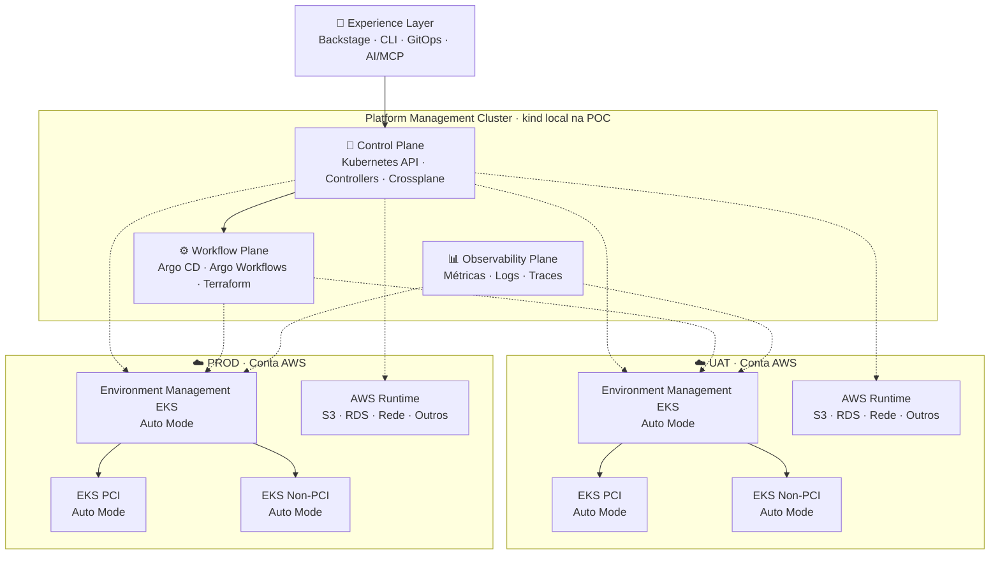

# 🏗️ Arquitetura da Platform Engineering POC

[← Página inicial](../README.md) · [📝 ADRs](adr/README.md) · [🧪 Roteiro prático](learning-roadmap.md)

**Situação:** arquitetura-alvo, não totalmente implementada. **Escopo:** dois ambientes — UAT e PROD — sem países, entidades ou referências corporativas.

## 🧱 Camadas arquiteturais



> **Como ler:** os cinco planes são responsabilidades lógicas. Linhas tracejadas representam integração, não topologia de rede AWS nem acesso administrativo já autorizado. Em cada conta há **três EKS distintos** — Management, PCI e Non-PCI — além dos recursos AWS Runtime.

**Control Plane, Workflow Plane, Observability Plane e Data Plane são nomes de responsabilidade arquitetural.** Os três primeiros compartilham um Platform Management Cluster no alvo. Cada ambiente do Data Plane mantém seu gerenciamento local e seus workloads. A nomenclatura Hub-and-Spoke é uma **interpretação complementar da topologia de gerenciamento**, não o nome de uma camada nem uma configuração obrigatória de rede AWS.

A arquitetura física-alvo prevê **sete clusters Kubernetes** (um central, três UAT e três PROD), sem exigir sua implantação simultânea. O Hub poderá rodar em `kind` local; **o provisionamento dos recursos será realizado em AWS real**, com conta existente inicialmente e autorização específica para cada operação.

## 🧩 Contratos Kubernetes-native
O **Kubernetes API Server** é a API oficial da plataforma, com três famílias de contratos:
- **`AWSEnvironment`:** representa uma conta AWS e seu ciclo de vida: criação/adoção, bootstrap, rede, segurança e clusters. Uma conta por ambiente; exclusão do CR nunca implica exclusão automática da conta.
- **`Domain`:** representa o ecossistema de aplicações/serviços e recursos compartilhados de um domínio de negócio. Vários Domains podem existir no mesmo Environment.
- **Capabilities especializadas:** `Database`, `ObjectStorage`, `ComputeInstance`, `Messaging` e outros tipos tipados. Cada CR especializado representa a própria instância consumida. **Não utilizar `CapabilityClaim` genérico na versão inicial.**

CRD é o mecanismo nativo de extensão da Kubernetes API; o **XRD do Crossplane define um recurso composto exposto nessa mesma API por um CRD**. Custom Resources são instâncias. Relações por `environmentRef` e `domainRef` são validadas por controllers/políticas — Kubernetes não garante integridade referencial automaticamente.

Exemplo **ilustrativo, ainda não instalado**:

```yaml
apiVersion: platform.lab.example/v1alpha1
kind: AWSEnvironment
metadata:
  name: uat
spec:
  stage: uat
  profile: standard
  clusters:
    management: true
    pci: true
    nonPCI: true
```

## 🧭 Experience Layer e GitOps
O Git é fonte da verdade para **estado desejado declarativo**. O Argo CD sincroniza recursos com a Kubernetes API; `status` e resultados operacionais permanecem no Kubernetes e nos sistemas de execução. Backstage, CLI e AI/MCP devem preferencialmente produzir PRs para mudanças persistentes. Consultas podem usar a API diretamente com RBAC. Evitar concorrência de escrita sobre o `spec` entre GitOps e `kubectl`.

## 🔄 Lifecycle de AWSEnvironment
1. O Environment Controller observa o recurso e valida autenticação, autorização, parâmetros e identidade da conta.
2. Aciona um **Argo Workflow versionado**, mantendo as etapas técnicas fora do contrato público.
3. O workflow cria/adota a conta, aguarda IPs quando necessário, executa Terraform para bootstrap/rede, valida subnets, rotas e conectividade e aguarda certificados ou aprovação humana.
4. Gates manuais usam suspensão/retomada com autorização, identidade, justificativa e evidência. Abrir um chamado não comprova execução nem substitui validações técnicas.
5. O fluxo prepara os clusters e atualiza condições como `AccountReady`, `NetworkReady`, `SecurityReady`, `ClustersReady` e `Ready`. Terraform state e logs não vão para o Git nem para o etcd.
6. Exclusão de conta requer processo deliberado e separado de descomissionamento.

## ☁️ Operação de cada ambiente
O Environment Management EKS é candidato a hospedar Argo CD local, controllers/operators aptos a reconciliação remota e gateway de observabilidade. O Argo CD local gerencia EKS PCI e EKS Non-PCI **somente se o isolamento administrativo PCI permitir**. Operators/agents que exigem acesso local permanecem nos clusters de workload. O AWS Runtime (RDS, S3, EC2, networking etc.) pertence à mesma conta AWS do respectivo ambiente.

## ⚠️ Limites e riscos
A indisponibilidade do Hub não deve automaticamente interromper workloads já existentes. O bootstrap e a recuperação do gerenciamento exigem plano próprio. Namespaces não oferecem isolamento equivalente a contas/clusters. Crossplane e Terraform não devem possuir simultaneamente o mesmo recurso AWS. Esta POC não implementa nem integra chamados reais automaticamente.

Leitura complementar: [ADRs](adr/README.md), [estrutura do monorepo](repository-structure.md) e [roteiro de aprendizado](learning-roadmap.md).

## ⚙️ Reconciliação e execução

O cliente (`kubectl`, Backstage, CLI ou AI/MCP) fala **sempre com o Kubernetes API Server**. Ele não chama diretamente o Crossplane como se fosse outra API. O API Server valida e armazena o CR; o reconciliador apropriado observa e atende ao `spec`, atualizando `status`.

| Contrato | Forma do contrato | Reconciliação |
| --- | --- | --- |
| `AWSEnvironment` | CRD nativo | Environment Controller próprio (Go/controller-runtime planejado), acionando Argo Workflows/Terraform |
| `Domain` | XRD Crossplane | Composition para Namespace e configurações Kubernetes; destino remoto precisa de integração validada |
| `Database`, `ObjectStorage`, `ComputeInstance`, `Messaging` | XRDs distintos | Crossplane Compositions + Providers para AWS |

**Crossplane fica no Control Plane**, ao lado do controller próprio e do catálogo de contratos. **Argo Workflows, Terraform Executor e Argo CD ficam no Workflow Plane**. O Crossplane reconcilia continuamente; ele não é um motor de workflows sequenciais nem precisa de Argo Workflows para entregar uma Capability.

O `Domain` começa como namespace e configurações (por exemplo quotas, limites e políticas). Um XRD no Hub não cria automaticamente objetos num EKS remoto: validar provider apropriado, credenciais, conexão e fronteiras PCI ou usar delegação GitOps local. Não desenvolver Domain Controller próprio inicialmente.

Não permitir que Terraform e Crossplane modifiquem simultaneamente o mesmo recurso externo. O Terraform fica preferencialmente responsável pela fundação dos ambientes; o Crossplane pelas Capabilities.

## ☁️ AWS real em três etapas

**Etapa 1 — Conta existente:** autenticar em uma conta AWS já disponível e executar labs com recursos reais, começando por operações de menor custo e risco. O Hub local pode utilizar `kind`. Mocks são úteis para testes isolados, mas não substituem a validação AWS.

**Etapa 2 — UAT e PROD:** usar duas contas reais distintas, previamente fornecidas e autenticadas, modelando os Spokes sem provisionar contas pelo controller. Isolar papéis IAM, configurações, estado Terraform, seleção de região e limites de gasto.

**Etapa 3 — Criar contas:** automatizar criação/adoção de contas por meio do `AWSEnvironment`, com fluxo de fundação, dependências humanas, aprovações e proteção contra exclusão. A criação de contas está **adiada**, não excluída da arquitetura-alvo.

Antes de qualquer alteração AWS: confirmar account ID e região usando STS, planejar a mudança, dimensionar custo, documentar autorização explícita, privilégios mínimos, proteção de credenciais, state remoto e limpeza/descomissionamento. Nenhum `apply` ou `destroy` automático apenas pela aprovação do PR de documentação.

## 🚀 EKS Auto Mode

Para os **clusters reais dos Data Planes**, adotar **Amazon EKS Auto Mode** inicialmente: Environment Management EKS, EKS PCI e EKS Non-PCI de UAT/PROD. O **Platform Management Cluster** permanece no **`kind` local** durante os primeiros laboratórios. A escolha reduz a manutenção direta de compute, nós, integração de load balancing, networking e storage, mas não elimina o gerenciamento de permissões, VPC, políticas, add-ons compatíveis, workloads, upgrades e custos.

O provisionamento deve declarar explicitamente Auto Mode nos módulos Terraform e validar a configuração do cluster, NodePools/NodeClasses quando necessários e compatibilidade dos componentes instalados. O recurso de Auto Mode gerencia nós com restrições: não pressupor SSH/SSM nos nós, customização livre de AMI ou instalação host-level. Agents compatíveis podem ser executados por DaemonSet; avaliar limitações e necessidades de PCI antes de adotar como definitivo.

A POC continua incremental: **não criar seis EKS reais simultaneamente** e manter gates de custo, conta/região verificados e cleanup. Caso um operator ou requisito de segurança precise de capacidade incompatível, registrar ADR de exceção, em vez de trocar silenciosamente o modelo.

Decisão detalhada: [ADR-0011](adr/0011-eks-auto-mode.md).


---

[← Página inicial](../README.md) · [ADRs](adr/README.md) · [Roteiro prático](learning-roadmap.md)
