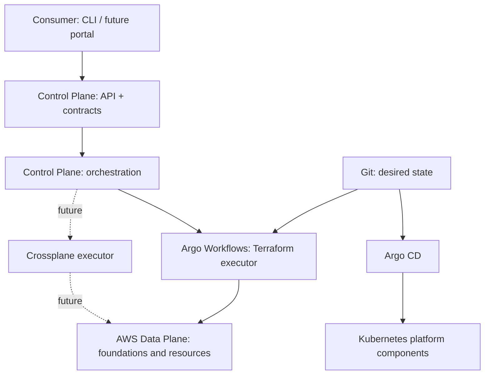

# Platform Engineering POC — Architecture

## Intent
Demonstrate a self-service platform where consumers request infrastructure through a stable contract. The control plane validates the request and delegates execution to a workflow engine. Git remains the source of truth.

## Boundaries
1. **Control Plane:** API, validation, service catalog contracts, authorization and execution tracking.
2. **Workflow/GitOps Plane:** Argo Workflows for imperative jobs; Argo CD for cluster reconciliation.
3. **Data Plane:** AWS accounts and environments, split conceptually into foundations and resources.
4. **Observability Plane:** metrics, logs, traces, audit trails and execution visibility (later).

## MVP scope
- A versioned, generic infrastructure request schema.
- A minimal API with input validation and a mock executor.
- A Terraform execution contract and an Argo Workflow template (subsequent milestone).
- Explicit target environment selection and approval before any real apply.

## Non-goals for the first milestone
- Production AWS provisioning, multi-tenant isolation, Backstage, Crossplane reconciliation and enterprise IAM integration.

## Security guardrails
Never store secrets or Terraform state in Git. Use least-privilege identity federation for AWS access. Keep plan and apply separate, with explicit approval for apply.
