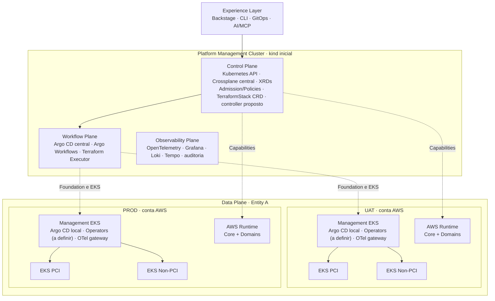
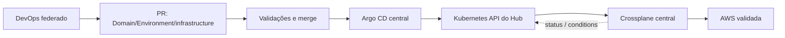

# 🏗️ Arquitetura da Platform Engineering POC

[← Início](../README.md) · [Decisões atuais](adr/README.md) · [Monorepo](repository-structure.md) · [Roadmap](learning-roadmap.md)

> [!NOTE]
> **Arquitetura-alvo, não implementada.** Um monorepo de laboratório simula ownership e autonomia federada. Nenhuma operação AWS está autorizada por este documento. Nomes de entidades e Domains são fictícios.

## 1. Modelo arquitetural

A POC demonstra uma plataforma **Kubernetes-native** de governança central e consumo federado. Existem duas dimensões distintas:

- **Planos:** Experience Layer, Control Plane, Workflow Plane, Observability Plane e Data Plane. Os três planos técnicos centrais coexistem no **Platform Management Cluster**, inicialmente `kind`.
- **Quatro camadas de ownership:** **Foundation → Entity Core Infrastructure → Domain Infrastructure → Domain Applications**. Elas classificam responsabilidade de mudança e lifecycle, **não** representam planos ou clusters adicionais.

A **Entity** reúne a operação organizacional. Um **Environment** (UAT/PROD) é o contexto de uma conta AWS. O **Domain** é a unidade lógica de negócio, consumo, ownership e governança: possui Capabilities e aplicações em um ou mais Environments. **Capability** é o produto técnico provisionável, como `ObjectStorage`.

**Environment não é sinônimo de Core Infrastructure**: o ambiente é a conta toda, incluindo Core e os recursos dos Domains.

## 2. Visão geral


[**Abrir diagrama em tamanho completo**](arquitetura%20Plataform.png) · O diagrama é **arquitetura-alvo**; não confirma recursos implantados. O contrato inicial `TerraformStack` está versionado na Etapa 05. O controller e os mecanismos de política e drift são entregas posteriores. GitHub Actions de aplicações opera fora do Hub.

### Topologia lógica (Mermaid)



Linhas tracejadas representam integração lógica, **não redes AWS nem permissões concedidas**. A arquitetura permite várias entidades. Cada entidade-alvo contém UAT e PROD em **contas AWS distintas**, cada uma com **Management EKS, EKS PCI, EKS Non-PCI** e serviços AWS. Na representação de **uma entidade** são sete clusters no total (Hub + 2×3), não um limite global. EKS Auto Mode é a preferência para EKS reais, **sob validação de custos, operadores e PCI**; criar um cluster de cada vez. O Argo CD local pode exigir segregação de instâncias/credenciais para PCI.

| Plano | Responsabilidade |
| :--- | :--- |
| **Experience Layer** | Consumidores independentes: Backstage, CLI, PR GitOps, AI/MCP; Backstage não é gateway obrigatório |
| **Control Plane** | Kubernetes API Server central, XRDs/Compositions/Providers de Capabilities, Crossplane e políticas |
| **Workflow Plane** | Argo CD central, Argo Workflows, Terraform Executor, aprovações; GitHub Actions de aplicações em repositório separado |
| **Observability Plane** | OpenTelemetry, Grafana, Loki, Tempo, métricas, eventos e auditoria |
| **Data Plane** | Contas AWS das Entities, Core compartilhado, Domains, Management EKS com Argo CD local/Operators/gateway de logs e EKS PCI/Non-PCI |

## 3. Quatro conceitos e seus contratos

| Conceito | Definição | Implementação **inicial** |
| :--- | :--- | :--- |
| **Entity** | Identidade organizacional que contém Environments e Domains | Organização declarativa no Git |
| **Environment** | Ambiente UAT/PROD da Entity associado a conta AWS, região e componentes previstos de Foundation e Core | Registro `environment.yaml` versionado/validado, **não CRD** |
| **Domain** | Unidade lógica de negócio que possui aplicações, namespaces, Capabilities, owners, padrões e políticas | Registro **único** `domain.yaml` por Domain, **não XRD** |
| **Capability** | Produto técnico consumível, com tipo, schema, lifecycle e status próprios | **Crossplane XRD + Composition + Provider** por produto |

A mesma identidade de Domain pode ter recursos diferentes em UAT e PROD. Um bucket, banco ou aplicação pertence ao par **Domain + Environment**. O namespace é a materialização do Domain em um cluster, não sua definição. O Core pertence ao Environment, nunca ao lifecycle de um Domain específico. **MSK está fora do escopo inicial**.

Exemplo **ilustrativo** de Environment, sob gestão da Foundation central:

```yaml
# foundation/config/entity-a/uat/environment.yaml
entity: entity-a
environment: uat
aws:
  accountId: "111122223333" # fictício
  region: us-east-1
foundation:
  networkBaseline: true
core:
  eksManagement: true
  eksNonPci: true
  eksPci: true
```

A Foundation confere `aws.accountId` e a região contra o destino aprovado. As flags de Foundation e Core declaram os componentes previstos. O provisionamento exige execução e aprovação próprias.

Exemplo **ilustrativo** de Domain (identidade única):

```yaml
# data-plane/entity-a/domains/rastreamento-encomendas/domain.yaml
domain: rastreamento-encomendas
entity: entity-a
owners: [team-rastreamento]
environments: [uat, prod]
policies:
  profile: standard
```

Esses YAMLs **não são manifests Kubernetes** e não devem ser sincronizados diretamente pelo Argo CD central. Inicialmente são lidos por validações e ferramentas de workflow. A vinculação confiável **Entity + Environment + Domain → conta/IAM/namespace** precisa ser construída e testada: consumidores não podem escolher credenciais AWS arbitrárias.

**`ObjectStorage` e `Database` são as duas primeiras Capabilities da POC**, nessa ordem. A primeira implementação de `Database` usará **Amazon Aurora PostgreSQL** (cluster Aurora), sem assumir que uma definição lógica de `Database` tenha de se limitar a Aurora em versões futuras; `Messaging` e `ComputeInstance` ficam no roadmap. **Não criar `CapabilityClaim` genérico.** Capabilities e Deployments são solicitações independentes.

### Decisões complementares da arquitetura-alvo

- **Contrato Terraform.** `TerraformStack` é o CRD Kubernetes próprio do Hub que representa **infraestrutura desejada** de Foundation/Entity Core. O Argo CD central sincroniza o manifesto; o controller coordena Argo Workflows/Terraform Executor para `plan` inicial e periódico, detecção de drift, classificação por Policy Engine (**auto apply / aprovação / bloqueio**) e atualização de status. **Não executar `apply` a cada reconcile**. `TerraformRun` permanece nome opcional de uma execução isolada, não um segundo CRD obrigatório. Ver [ADR-0006](adr/0006-terraformrun-and-application-ci.md).
- **Domain Applications:** as squads manterão **código, GitHub Actions e manifests Kubernetes da aplicação em repositório próprio**, separado deste monorepo e previsto para uma etapa posterior. O pipeline faz build/testes/scans e publicação, propõe atualização declarativa GitOps; **Argo CD local** em cada Management EKS faz o deploy nos EKS PCI/Non-PCI autorizados. O workflow CI existente neste monorepo só valida a POC.
- **Management EKS:** **Operators ainda a estudar**; usar **OpenTelemetry Collector/gateway** para encaminhar telemetria à camada central, não assumir Loki instalado dentro de todos os Management EKS.
- **Observabilidade central:** **OpenTelemetry, Grafana, Loki e Tempo**; estratégia de métricas/Prometheus, retenção e fronteiras PCI a validar no laboratório.

### Personas, limites de abstração e modelo de consumo

Existem **três personas**, não quatro equipes para as quatro camadas de ownership:

| Persona | Papel | Conhecimento e responsabilidades |
| :--- | :--- | :--- |
| **Platform Team** | Construir/operar a plataforma como produto | Control/Workflow/Observability Planes, contratos, módulos/Compositions, policies, Golden Paths, Foundation e Entity Core compartilhados |
| **DevOps Federado (Federated DevOps Team)** | Ponte técnica entre plataforma e squads | Conhece catálogo/contratos e mantém **Domain Infrastructure**, usando Capabilities para Database, ObjectStorage, Messaging, alterações e upgrades; solicita evolução da plataforma quando necessário |
| **Squads de Produto (Application Team / Developers)** | Construir o produto de negócio | Código, testes, CI/CD, imagens e **manifests Kubernetes da aplicação** no repositório da squad, consumindo Starter Kits e padrões da plataforma sem conhecer motores internos |

**O desenvolvimento não precisa aprender a implementação interna de Crossplane, Terraform ou Argo para criar um serviço.** O DevOps Federado tem conhecimento mais aprofundado de consumo e lifecycle das Capabilities, mas não administra o Control Plane nem os módulos centrais. EKS compartilhado e seu upgrade/provisioning são governados pelo Platform Team (DevOps Federado pode propor).

**Dois tipos de Capabilities:** **Infrastructure Capabilities** (Crossplane especializado, consumido pelo DevOps Federado) e **Application Capabilities** (padrões de runtime/build/deploy/telemetria, consumidos pelos desenvolvedores; **não implicam XRD Crossplane**). Um **Golden Path / Starter Kit** combina padrões e automações para uma jornada específica. Backstage, CLI e Git são canais alternativos; Backstage não é gateway obrigatório.

**Aplicação mínima da POC (preferencialmente Python + Flask).** Após provisionar EKS e configurar o Argo CD local, usar a aplicação na Etapa 12 para testar deploy, conectividade e health check. Após observabilidade e governança, preparar a Developer Experience na Etapa 22. Na Etapa 24, reutilizar a aplicação para demonstrar o Golden Path com CI/CD e telemetria. O DevOps Federado solicita as Capabilities para o Domain. [ADR-0007](adr/0007-personas-and-developer-experience.md)

## 4. Quatro camadas de ownership

| Camada | Quem solicita | Quem controla execução e lifecycle | Recursos / motor |
| :--- | :--- | :--- | :--- |
| **Foundation** | Plataforma central; federado pode propor PR | Plataforma central | Conta, landing zone, rede, IAM; **Terraform** e configurações por Entity/Environment |
| **Entity Core Infrastructure** | DevOps federado nos limites autorizados | Plataforma governa componentes críticos | Três EKS e recursos comuns por Environment; **Terraform para EKS** |
| **Domain Infrastructure** | DevOps Federado (solicita/gerencia intenção no Git) | DevOps Federado sob guardrails da plataforma; Crossplane central reconcilia | Capabilities Database, ObjectStorage, Messaging via **XRDs** e contratos aprovados |
| **Domain Applications** | Application Team | Squad mantém código e manifests no repo da aplicação; GitHub Actions CI/CD + Argo CD local | Código, testes, build/scan/publicação, manifests de aplicação, Deployments/Services/HPA e runtime autorizado |

Um recurso externo tem **um único owner de reconciliação**. Terraform administra Foundation/EKS; Crossplane as Capabilities que lhe forem atribuídas. Core futuro pode conter Capability compartilhada, desde que tenha owner explícito e não seja excluída pela remoção de um Domain consumidor.

## 5. Organização do monorepo

```text
platform-engineering-poc/
├── platform/hub/                        # bootstrap kind
├── control-plane/                       # Crossplane, Capabilities e políticas
├── workflow-plane/                      # GitOps central, Workflows, Terraform
├── observability-plane/
├── foundation/                          # central, a criar no lab
│   ├── modules/
│   └── config/entity-a/
│       ├── uat/environment.yaml
│       └── prod/environment.yaml
├── data-plane/
│   └── entity-a/
│       ├── core-infrastructure/         # compartilhado por ambiente
│       │   ├── uat/
│       │   │   ├── management-eks/
│       │   │   ├── eks-pci/
│       │   │   └── eks-non-pci/
│       │   └── prod/
│       │       ├── management-eks/
│       │       ├── eks-pci/
│       │       └── eks-non-pci/
│       └── domains/
│           ├── rastreamento-encomendas/
│           │   ├── domain.yaml          # identidade única
│           │   ├── uat/
│           │   │   └── infrastructure/  # XRs · DevOps Federado
│           │   └── prod/
│           │       └── infrastructure/  # XRs · DevOps Federado
│           ├── estoque/
│           └── planejamento-rotas/
├── docs/
├── labs/                               # guias das etapas
└── tests/
```

**Repositório da aplicação de teste.** Previsto para a Etapa 12, pertence às **Squads de Produto (Application Team)** e inclui `src/`, `tests/`, `Dockerfile`, `.github/workflows/` e `k8s/{base,overlays/uat,overlays/prod}`. O **Argo CD local** sincroniza esses manifests diretamente desse repositório.

**Esta é a árvore-alvo.** A Etapa 01 cria o Hub `kind` local. O roteiro usa o registro de UAT na Etapa 07 para preparar a primeira execução na AWS e o de PROD na Etapa 20 para testar isolamento. Novos diretórios de Domain e Foundation acompanham as respectivas entregas. A [estrutura](repository-structure.md) especifica essa transição.

O monorepo demonstra autonomia via PR, revisão de paths e eventualmente CODEOWNERS. **CODEOWNERS sem regras de proteção não basta;** também são necessários RBAC Kubernetes, admission, IAM por conta e AppProjects Argo CD. Terraform state fica fora do Git.


## 6. Registro e entrega de um Domain

Na Etapa 23, a equipe registra o Domain em `data-plane/<entity>/domains/<domain>/domain.yaml` com identidade, ownership e Environments autorizados. Cada entrega passa por revisão no Git.

- **Infraestrutura do Domain.** O DevOps Federado declara as Capabilities necessárias em `data-plane/<entity>/domains/<domain>/<env>/infrastructure/`. O Argo CD central aplica os CRs, e o Crossplane reconcilia os recursos AWS no destino aprovado.
- **Configuração e aplicação.** O Argo CD local entrega namespaces, políticas e workloads nos destinos autorizados. Na Etapa 24, a squad demonstra a entrega com código, CI e manifests Kubernetes no repositório da aplicação.
- **Prontidão.** Verificar, por Environment, as condições `Ready` das Capabilities solicitadas e o estado de sincronização e saúde dos recursos Kubernetes. O registro de Domain documenta identidade e ownership.
- **Remoção.** Descomissionar recursos por operação aprovada, após avaliar dependências e retenção.

## 7. Três fluxos sem sobreposição

### Foundation / Entity Core: Terraform orquestrado

```text
foundation/config/ ou core-infrastructure/ (Git)
  → validação de intenção + PR/aprovação
  → Argo CD central → Kubernetes API / TerraformStack CR
  → TerraformStack Controller → Argo Workflows
  → Terraform Executor: plan → Policy Engine
  → auto apply / aprovação / bloqueio
  → verificação e status → AWS Foundation / EKS
  → nova verificação periódica de drift (sem apply incondicional)
```

O Bootstrap Terraform central é reutilizado por configuração de Entity/Environment, com **state segregado**. Inicialmente pode rodar em um lab manual e auditável. **Argo CD não executa Terraform**. Criar conta AWS automaticamente é possibilidade futura, **não exige `AWSEnvironment` CRD/controller próprio agora**.

### Evolução planejada do TerraformStack

1. **Etapas 05 e 06 — Contrato e execução local.** Validar o CRD na API do Hub e exercitar Git → Argo CD central → controller → Workflow com executor simulado.
2. **Etapas 07 a 09 — Primeira execução na AWS.** Registrar UAT, validar a identidade do executor e preparar o backend de estado. Gerar o plano da rede, obter aprovação humana vinculada ao plano e aplicar o mesmo artefato.
3. **Etapas 18 e 19 — Drift e reconciliação por políticas.** Detectar drift numa stack aplicada e publicá-lo no status antes de habilitar qualquer remediação. Em seguida, aplicar decisões versionadas e auditáveis para auto apply autorizado, aprovação obrigatória ou bloqueio.

O schema inicial do CRD é validado na Etapa 05 e a implementação do Policy Engine na Etapa 19. O Argo CD central sincroniza o CR Kubernetes. Argo Workflows executa os passos de plan, aprovação e apply.

### Domain Infrastructure: Argo CD central + Crossplane



Neste fluxo de **Domain Infrastructure**, o Argo CD central sincroniza CRs Kubernetes de **Capability**; na arquitetura completa também sincronizará `TerraformStack`, para Foundation/Entity Core. Os registros de Domain/Environment informam ownership/destino após validação, **não são CRs**; **Crossplane não observa Git diretamente**. Em cada Capability validar schema, escopo, credenciais e política de deletion.

### Domain Applications: GitHub Actions + GitOps local

```text
repositorio-da-aplicacao/k8s/overlays/<env>/ (Git da squad)
  → Argo CD no Management EKS daquele Environment
  → EKS PCI ou Non-PCI permitido
  → Namespaces / quotas / policies / Deployments / Services
```

O código, as pipelines GitHub Actions **e os manifests Kubernetes da aplicação** ficarão **juntos no repositório separado da squad** (não neste monorepo). A pipeline publica imagem e propõe mudanças GitOps; o Argo CD local aplica os manifests aprovados. **Manifests de Infrastructure Capabilities** continuam no monorepo sob gestão do DevOps Federado. Uma Composition Crossplane central não deve possuir esses mesmos namespaces. O controle PCI requer avaliação das permissões de acesso e eventual segregação do GitOps local.

## 8. Segurança, exclusão, drift e falhas

- **AWS real.** Validar o registro de UAT antes da primeira execução real e o de PROD para os testes de isolamento entre contas. Conferir identidade e conta via STS, região de destino, credenciais temporárias, IAM mínimo, orçamento e aprovação explícita **a cada execução**. A automação de criação de contas é uma extensão opcional.
- **Isolamento:** validar negativa para tentativas de Domain A acessar Domain B ou UAT selecionar role/conta PROD. Paths Git e namespaces não equivalem a isolamento de contas AWS.
- **Exclusão:** conta AWS **nunca** é apagada por excluir YAML; EKS só com gate e análise de dependências. Capabilities devem ter políticas de retenção/deletion testadas. Finalizer **não é aprovação humana**.
- **Drift:** Crossplane reconcilia Capabilities continuamente enquanto o Hub estiver disponível; Terraform não reconcilia sem execução; Argo CD local continua operando aplicações se seu acesso ao Git e clusters permanecer válido.
- **Observabilidade:** correlacionar revisão Git, aplicação Argo CD, execução Terraform, XR, condições `Ready` e eventos AWS.

## 9. Nascimento de uma entidade versus ordem pedagógica

**Fluxo operacional alvo.** Foundation cria ou adota contas e rede → Entity Core prepara EKS e Argo CD local → manifests de Capabilities aprovados são reconciliados por Crossplane central → workloads de Domain Applications são entregues por Argo CD local.

**POC pedagógica.** Preparação do Hub local → `TerraformStack` e rede UAT → clusters e smoke test → Capabilities com Crossplane → observabilidade e operação → Experience Layer → Golden Path. O [roteiro prático](learning-roadmap.md) organiza essas fases nas Etapas 00 a 24. A UAT recebe os primeiros recursos reais, com expansão incremental de clusters conforme identidade, rede, custo e isolamento forem validados.

## 10. Decisões vigentes e pontos abertos

**Atualização:** o CRD TerraformStack está versionado na Etapa 05. O controller e a reconciliação por políticas são entregas posteriores. GitHub Actions das aplicações opera no repositório da squad. OpenTelemetry, Grafana, Loki e Tempo compõem a stack-alvo. Os Operators locais ainda serão selecionados.

**Fechado:** Domain como unidade lógica de consumo/ownership, Environment como destino AWS, Entity como organização, Capability como XRD especializado, quatro camadas (incluindo **Domain Applications**), monorepo, Crossplane central sem cascata, Terraform para Foundation/EKS, GitOps central de infra e local de aplicações, AWS real gradual e Auto Mode como preferência.

**A validar no roteiro:** federação do Provider AWS na UAT com renovação de sessão, arquitetura de rede e custo do Aurora PostgreSQL, schema dos YAMLs, transformação segura de registros lógicos em escopo/credenciais, distribuição de namespaces/quotas ao GitOps local, gates, observabilidade, PCI e necessidade eventual de uma API/controller de ciclo de vida de contas.

[Decisões](adr/README.md) · [Monorepo](repository-structure.md) · [Roteiro](learning-roadmap.md)
