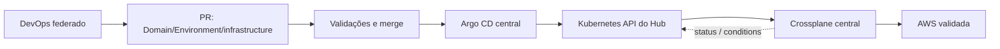

# 🏗️ Arquitetura da Platform Engineering POC

[← Início](../README.md) · [Decisões atuais](adr/README.md) · [GitOps Flow](flows/gitops.md) · [Monorepo](repository-structure.md) · [Roadmap](learning-roadmap.md)

> [!NOTE]
> O Hub da POC começa no EKS Auto Mode da conta de plataforma. O desenho descreve a topologia-alvo na AWS e o modelo de ownership que o monorepo exercita. Os exemplos usam entidades e Domains fictícios. Operações AWS exigem autorização por etapa.

## 1. Modelo arquitetural

A POC demonstra uma plataforma **Kubernetes-native** de governança central e consumo federado. Existem duas dimensões distintas:

- **Planos:** Experience Layer, Control Plane, Workflow Plane, Observability Plane e Data Plane. Os três planos técnicos centrais ficam na conta da plataforma em torno do Hub EKS.
- **Quatro camadas de ownership:** **Foundation → Entity Core Infrastructure → Domain Infrastructure → Domain Applications**. Elas classificam responsabilidade de mudança e lifecycle, **não** representam planos ou clusters adicionais.

A **Entity** reúne a operação organizacional. Um **Environment** (UAT/PROD) é o contexto de uma conta AWS. O **Domain** é a unidade lógica de negócio, consumo, ownership e governança: possui Capabilities e aplicações em um ou mais Environments. **Capability** é o produto técnico provisionável, como `ObjectStorage`.

**Environment não é sinônimo de Core Infrastructure**: o ambiente é a conta toda, incluindo Core e os recursos dos Domains.

## 2. Visão geral

**Fluxos declarativos detalhados:** [GitOps Flow](flows/gitops.md) · [Diagrama PNG](flows/gitops-flow.png) · [TerraformStack Flow](flows/terraformstack.md) · [GitOps Bridge Flow](flows/gitops-bridge.md). O fluxo diferencia Platform Addons, Capabilities Crossplane, TerraformStack e aplicações locais, incluindo a divisão de ownership.


[Abrir diagrama em tamanho completo](arquitetura%20Plataform.png)

A [Etapa 01](../labs/01-platform-management-cluster.md) documenta o Hub EKS provisionado com Argo CD gerenciado. O smoke test com workload e o primeiro sync da [Etapa 02](../labs/02-argocd-central.md) ainda precisam ser executados. O Simulator e o Crossplane serão exercitados nesse Hub com recursos Kubernetes de teste. [Evidências do Simulator](../labs/06-terraformstack-simulator.md#evidências-de-aceite) · [Crossplane Core](../labs/07-crossplane-core.md) · [Roadmap](learning-roadmap.md).

O Hub EKS, as spokes, o consumo de Capabilities AWS, o GitOps Bridge e a stack de telemetria central compõem a arquitetura-alvo. A Foundation mantém raízes reutilizáveis e utilitários versionados para as etapas AWS. A entrega das aplicações usará o repositório da squad e o Argo CD local. [Foundation](../foundation/README.md) · [GitOps Bridge](flows/gitops-bridge.md).

| Plano | Responsabilidade |
| :--- | :--- |
| **Experience Layer** | Consumidores independentes: Backstage, CLI, PR GitOps, AI/MCP; Backstage não é gateway obrigatório |
| **Control Plane** | Kubernetes API Server, Crossplane central, TerraformStack Controller, RBAC e admission Kubernetes |
| **Workflow Plane** | Argo CD central, Argo Workflows, runner e Policy Engine da implementação de referência |
| **Observability Plane** | OpenTelemetry, Grafana, Loki, Tempo, métricas, eventos e auditoria |
| **Data Plane** | Contas AWS das Entities, Core compartilhado, Domains, Management EKS com Argo CD local/Operators/gateway de logs e EKS PCI/Non-PCI |

## 3. Quatro conceitos e seus contratos

| Conceito | Definição | Implementação **inicial** |
| :--- | :--- | :--- |
| **Entity** | Identidade organizacional que contém Environments e Domains | Organização declarativa no Git |
| **Environment** | Ambiente UAT/PROD da Entity associado a conta AWS, região e componentes previstos de Foundation e Core | Registro `environment.yaml` versionado/validado, **não CRD** |
| **Domain** | Unidade lógica de negócio que possui aplicações, namespaces, Capabilities, owners, padrões e políticas | Registro **único** `domain.yaml` por Domain, **não XRD** |
| **Capability** | Produto técnico consumível, com tipo, schema, lifecycle e status próprios | **Crossplane XRD + Composition + Provider** por produto |

A mesma identidade de Domain pode ter recursos diferentes em UAT e PROD. Um bucket, banco ou aplicação pertence ao par **Domain + Environment**. O namespace é a materialização do Domain em um cluster, não sua definição. O Core pertence ao Environment, nunca ao lifecycle de um Domain específico. **MSK está fora do escopo inicial**.

Exemplo **ilustrativo** de Environment, sob gestão da Foundation central:

```yaml
# foundation/config/entity-a/uat/environment.yaml
entity: entity-a
environment: uat
aws:
  accountId: "111122223333" # fictício
  region: us-east-1
foundation:
  networkBaseline: true
core:
  eksManagement: true
  eksNonPci: true
  eksPci: true
```

As flags de Foundation e Core do registro descrevem a topologia prevista; não habilitam diretamente os recursos das raízes Terraform. Os YAMLs de stack (`network.yaml`, `eks.yaml`) e seus overrides determinam a configuração efetiva. Em UAT, Management começa habilitado, Non-PCI e PCI começam desabilitados. A integração AWS deve validar `aws.accountId`, região e identidade do destino aprovado. O provisionamento exige execução e aprovação próprias. [Foundation](../foundation/README.md).

Exemplo **ilustrativo** de Domain (identidade única):

```yaml
# data-plane/entity-a/domains/rastreamento-encomendas/domain.yaml
domain: rastreamento-encomendas
entity: entity-a
owners: [team-rastreamento]
environments: [uat, prod]
policies:
  profile: standard
```

Esses YAMLs **não são manifests Kubernetes** e não devem ser sincronizados diretamente pelo Argo CD central. Inicialmente são lidos por validações e ferramentas de workflow. A vinculação confiável **Entity + Environment + Domain → conta/IAM/namespace** precisa ser construída e testada: consumidores não podem escolher credenciais AWS arbitrárias.

**`ObjectStorage` e `Database` são as duas primeiras Capabilities da POC**, nessa ordem. A primeira implementação de `Database` usará **Amazon Aurora PostgreSQL** (cluster Aurora), sem assumir que uma definição lógica de `Database` tenha de se limitar a Aurora em versões futuras; `Messaging` e `ComputeInstance` ficam no roadmap. **Não criar `CapabilityClaim` genérico.** Capabilities e Deployments são solicitações independentes.

### Decisões complementares da arquitetura-alvo

- **Contrato Terraform.** `TerraformStack` é o CRD Kubernetes próprio do Hub que representa **infraestrutura desejada** de Foundation/Entity Core. O Argo CD central sincroniza o manifesto. O controller Go coordena a execução inicial, as checagens periódicas e as dependências, preservando um Workflow ativo por CR. O CR seleciona um alias cadastrado ou o default. A autorização operacional é habilitada por padrão, mas configurável por integração. A pipeline de referência em Argo Workflows resolve Git, contexto e state, avalia o plano com OPA e aplica a alteração autorizada após o claim. O adapter entrega o resultado tipado ao controller, que atualiza o status do CR. [ADR-0009](adr/0009-terraformstack-runtime.md) · [Execution Contract](flows/terraformstack-execution-contract.md).
- **Domain Applications:** as squads manterão **código, GitHub Actions e manifests Kubernetes da aplicação em repositório próprio**, separado deste monorepo e previsto para uma etapa posterior. O pipeline faz build/testes/scans e publicação, propõe atualização declarativa GitOps; **Argo CD local** em cada Management EKS faz o deploy nos EKS PCI/Non-PCI autorizados. O workflow CI existente neste monorepo só valida a POC.
- **Management EKS:** **Operators ainda a estudar**; usar **OpenTelemetry Collector/gateway** para encaminhar telemetria à camada central, não assumir Loki instalado dentro de todos os Management EKS.
- **Observabilidade do controller:** logs JSON, Events Kubernetes e métricas nativas e por CR já são disponibilizados sem dependência de coletores ou backends externos. A saúde deriva do status persistido; a coleta e os alertas pertencem ao operador. [Operação](../control-plane/terraformstack/controller/README.md).
- **Observabilidade central:** **OpenTelemetry, Grafana, Loki e Tempo**; estratégia de métricas/Prometheus, retenção e fronteiras PCI a validar no laboratório.

### Personas, limites de abstração e modelo de consumo

Existem **três personas**, não quatro equipes para as quatro camadas de ownership:

| Persona | Papel | Conhecimento e responsabilidades |
| :--- | :--- | :--- |
| **Platform Team** | Construir/operar a plataforma como produto | Control/Workflow/Observability Planes, contratos, módulos/Compositions, policies, Golden Paths, Foundation e Entity Core compartilhados |
| **DevOps Federado (Federated DevOps Team)** | Ponte técnica entre plataforma e squads | Conhece catálogo/contratos e mantém **Domain Infrastructure**, usando Capabilities para Database, ObjectStorage, Messaging, alterações e upgrades; solicita evolução da plataforma quando necessário |
| **Squads de Produto (Application Team / Developers)** | Construir o produto de negócio | Código, testes, CI/CD, imagens e **manifests Kubernetes da aplicação** no repositório da squad, consumindo Starter Kits e padrões da plataforma sem conhecer motores internos |

**O desenvolvimento não precisa aprender a implementação interna de Crossplane, Terraform ou Argo para criar um serviço.** O DevOps Federado tem conhecimento mais aprofundado de consumo e lifecycle das Capabilities, mas não administra o Control Plane nem os módulos centrais. EKS compartilhado e seu upgrade/provisioning são governados pelo Platform Team (DevOps Federado pode propor).

**Dois tipos de Capabilities:** **Infrastructure Capabilities** (Crossplane especializado, consumido pelo DevOps Federado) e **Application Capabilities** (padrões de runtime/build/deploy/telemetria, consumidos pelos desenvolvedores; **não implicam XRD Crossplane**). Um **Golden Path / Starter Kit** combina padrões e automações para uma jornada específica. Backstage, CLI e Git são canais alternativos; Backstage não é gateway obrigatório.

**Aplicação de referência da POC: Python FastAPI + Jinja2/HTML/CSS.** A Etapa 18 valida um workload HTTP mínimo no Non-PCI. Na **Fase 5 (Etapas 22–25)**, o repositório da squad entrega a tela de registro e consulta de encomendas; a API persiste no **Aurora PostgreSQL** e publica um JSON de evidência no **S3**, ambos via Capabilities Crossplane. A esteira **GitHub Actions → ECR → atualização GitOps → Argo CD local** constrói e entrega a aplicação. A **Fase 7 (32–33)** estrutura a experiência e a **Fase 8 (34–35)** reutiliza a aplicação para comprovar o Golden Path com as três personas. [ADR-0007](adr/0007-personas-and-developer-experience.md)

## 4. Quatro camadas de ownership

| Camada | Quem solicita | Quem controla execução e lifecycle | Recursos / motor |
| :--- | :--- | :--- | :--- |
| **Foundation** | Plataforma central; federado pode propor PR | Plataforma central | Conta, landing zone, rede, IAM; **Terraform** e configurações por Entity/Environment |
| **Entity Core Infrastructure** | DevOps federado nos limites autorizados | Plataforma governa componentes críticos | Três EKS e recursos comuns por Environment; **Terraform para EKS** |
| **Domain Infrastructure** | DevOps Federado (solicita/gerencia intenção no Git) | DevOps Federado sob guardrails da plataforma; Crossplane central reconcilia | Capabilities Database, ObjectStorage, Messaging via **XRDs** e contratos aprovados |
| **Domain Applications** | Application Team | Squad mantém código e manifests no repo da aplicação; GitHub Actions CI/CD + Argo CD local | Código, testes, build/scan/publicação, manifests de aplicação, Deployments/Services/HPA e runtime autorizado |

Um recurso externo tem **um único owner de reconciliação**. Terraform administra Foundation/EKS; Crossplane as Capabilities que lhe forem atribuídas. Core futuro pode conter Capability compartilhada, desde que tenha owner explícito e não seja excluída pela remoção de um Domain consumidor.

## 5. Organização do monorepo

```text
platform-engineering-poc/
├── platform/hub/                        # catálogo de add-ons e utilitários do Hub
├── control-plane/                       # Crossplane, TerraformStack e contratos
├── workflow-plane/                      # GitOps central, Workflows, runner e Policy Engine
├── observability-plane/
├── foundation/                          # infraestrutura central
│   ├── modules/
│   └── config/entity-a/
│       ├── uat/environment.yaml
│       └── prod/environment.yaml
├── data-plane/
│   └── entity-a/
│       ├── core-infrastructure/         # compartilhado por ambiente
│       │   ├── uat/
│       │   │   ├── management-eks/
│       │   │   ├── eks-pci/
│       │   │   └── eks-non-pci/
│       │   └── prod/
│       │       ├── management-eks/
│       │       ├── eks-pci/
│       │       └── eks-non-pci/
│       └── domains/
│           ├── rastreamento-encomendas/
│           │   ├── domain.yaml          # identidade única
│           │   ├── uat/
│           │   │   └── infrastructure/  # XRs · DevOps Federado
│           │   └── prod/
│           │       └── infrastructure/  # XRs · DevOps Federado
│           ├── estoque/
│           └── planejamento-rotas/
├── docs/
├── labs/                               # guias das etapas
└── tests/
```

**Repositório da aplicação de teste.** Previsto para a Fase 5 (Etapas 22–25), pertence às **Squads de Produto (Application Team)** e inclui `src/`, `tests/`, `Dockerfile`, `.github/workflows/` e `k8s/{base,overlays/uat,overlays/prod}`. O **Argo CD local** sincroniza esses manifests diretamente desse repositório.

**Esta é a árvore-alvo.** A Etapa 01 provisiona o Hub EKS na conta de plataforma. O roteiro usa o registro de UAT na Etapa 11 para preparar a primeira execução na AWS e o de PROD na Etapa 31 para testar isolamento. Novos diretórios de Domain e Foundation acompanham as respectivas entregas. A [estrutura](repository-structure.md) especifica essa transição.

O monorepo demonstra autonomia via PR, revisão de paths e eventualmente CODEOWNERS. **CODEOWNERS sem regras de proteção não basta;** também são necessários RBAC Kubernetes, admission, IAM por conta e AppProjects Argo CD. Terraform state fica fora do Git.


## 6. Registro e entrega de um Domain

Na Etapa 34, a equipe registra o Domain em `data-plane/<entity>/domains/<domain>/domain.yaml` com identidade, ownership e Environments autorizados. Cada entrega passa por revisão no Git.

- **Infraestrutura do Domain.** O DevOps Federado declara as Capabilities necessárias em `data-plane/<entity>/domains/<domain>/<env>/infrastructure/`. O Argo CD central aplica os CRs, e o Crossplane reconcilia os recursos AWS no destino aprovado.
- **Configuração e aplicação.** O Argo CD local entrega namespaces, políticas e workloads nos destinos autorizados. Na Etapa 35, a squad demonstra a entrega com código, CI e manifests Kubernetes no repositório da aplicação.
- **Prontidão.** Verificar, por Environment, as condições `Ready` das Capabilities solicitadas e o estado de sincronização e saúde dos recursos Kubernetes. O registro de Domain documenta identidade e ownership.
- **Remoção.** Descomissionar recursos por operação aprovada, após avaliar dependências e retenção.

## 7. Três fluxos sem sobreposição

### Foundation / Entity Core: Terraform orquestrado

```text
foundation/config/ ou core-infrastructure/ (Git)
  → validação de intenção + PR/aprovação
  → Argo CD central → Kubernetes API / TerraformStack CR
  → TerraformStack Controller → Argo Workflows
  → Pipeline: resolução de Git, contexto e state → plan → OPA e decisão
     ├─ NoChanges → resultado sem alteração
     ├─ AutoApply ou aprovação → autorização e claim → apply → verify
     └─ Bloqueio → status ReconcileBlocked
  → resultado tipado e nova checagem conforme o intervalo de drift
```

O Bootstrap Terraform central é reutilizado por configuração de Entity/Environment, com **state segregado**. Inicialmente pode rodar em um lab manual e auditável. **Argo CD não executa Terraform**. Criar conta AWS automaticamente é possibilidade futura, **não exige `AWSEnvironment` CRD/controller próprio agora**.

O controller encaminha a fonte declarada e o mapa de contexto. A interface de execução e o adapter Argo traduzem os sinais de execução. Git, identidade efetiva, backend, variáveis e política são resolvidos pela pipeline, que publica uma referência imutável e um vínculo opaco de destino. Argo é o único tipo de adapter implementado; a instalação pode cadastrar vários WorkflowTemplates Argo, com aliases e ServiceAccounts próprios. O fluxo acima representa a pipeline de referência governada, não etapas obrigatórias para todo template. Cada integração respeita o contrato configurado, incluindo resolução e resultado; o handshake pode ser desabilitado sem desabilitar políticas ou aprovação humana. Sem claim, o controller não infere o início do apply nem cancela automaticamente uma execução ativa para substituí-la. O Platform Team controla templates, identidades e políticas. [ADR-0009](adr/0009-terraformstack-runtime.md) · [Execution Contract](flows/terraformstack-execution-contract.md).

### Evolução planejada do TerraformStack

1. **Etapas 01–02.** Provisionar o Hub EKS e validar o primeiro sync com Argo CD gerenciado.
2. **Etapas 04–10.** Aceitar TerraformStack e Crossplane no Hub, consolidar evidências e preparar os requisitos para as spokes.
3. **Etapas 11–13.** Preparar UAT e o backend. Gerar, aprovar e aplicar o mesmo plano da rede da spoke.

No Simulator, a alteração verificada chega a um ConfigMap no Hub. A integração das raízes AWS ao mesmo contrato de execução entra nas Etapas 12–13. As Etapas 28–29 exercitam drift e políticas em UAT.

### Domain Infrastructure: Argo CD central + Crossplane



O Argo CD central sincroniza os CRs de Capability de Domain Infrastructure e os CRs de `TerraformStack` de Foundation e Entity Core. Os registros de Domain e Environment informam ownership e destino após validação. Crossplane observa os CRs pela API Kubernetes. Em cada Capability, validar schema, escopo, credenciais e política de deletion. [Fluxo do TerraformStack](flows/terraformstack.md)

### Domain Applications: GitHub Actions + GitOps local

```text
repositorio-da-aplicacao/k8s/overlays/<env>/ (Git da squad)
  → Argo CD no Management EKS daquele Environment
  → EKS PCI ou Non-PCI permitido
  → Namespaces / quotas / policies / Deployments / Services
```

O código, as pipelines GitHub Actions **e os manifests Kubernetes da aplicação** ficarão **juntos no repositório separado da squad** (não neste monorepo). A pipeline publica imagem e propõe mudanças GitOps; o Argo CD local aplica os manifests aprovados. **Manifests de Infrastructure Capabilities** continuam no monorepo sob gestão do DevOps Federado. Uma Composition Crossplane central não deve possuir esses mesmos namespaces. O controle PCI requer avaliação das permissões de acesso e eventual segregação do GitOps local.

## 8. Segurança, exclusão, drift e falhas

- **AWS real.** Validar o registro de UAT antes da primeira execução real e o de PROD para os testes de isolamento entre contas. Conferir identidade e conta via STS, região de destino, credenciais temporárias, IAM mínimo, orçamento e aprovação explícita **a cada execução**. A automação de criação de contas é uma extensão opcional.
- **Isolamento:** validar negativa para tentativas de Domain A acessar Domain B ou UAT selecionar role/conta PROD. Paths Git e namespaces não equivalem a isolamento de contas AWS.
- **Exclusão:** conta AWS **nunca** é apagada por excluir YAML; EKS só com gate e análise de dependências. Capabilities devem ter políticas de retenção/deletion testadas. Finalizer **não é aprovação humana**.
- **Drift:** Crossplane reconcilia Capabilities continuamente enquanto o Hub estiver disponível; Terraform não reconcilia sem execução; Argo CD local continua operando aplicações se seu acesso ao Git e clusters permanecer válido.
- **Observabilidade:** correlacionar revisão Git, aplicação Argo CD, execução Terraform, XR, condições `Ready` e eventos AWS.

## 9. Nascimento de uma entidade e ordem de implementação

**Conectividade GitOps.** O Hub EKS adota Amazon EKS Capability for Argo CD como Argo CD central. Platform, UAT e PROD têm VPCs isoladas, NAT Gateway e APIs EKS privadas. Registro por ARN e Access Entries permite sincronização cross-account pela conectividade gerenciada AWS, sem Peering/TGW. O próprio Hub EKS também requer registro por ARN. Argo CD local permanece no Management EKS. Essa conectividade gerenciada se limita à sincronização de APIs pelo Argo CD central. [ADR-0008](adr/0008-managed-argocd-connectivity.md)

**Fluxo operacional alvo.** Foundation cria ou adota contas e rede → Entity Core prepara EKS e Argo CD local → manifests de Capabilities aprovados são reconciliados por Crossplane central → workloads de Domain Applications são entregues por Argo CD local.

**Ordem incremental da POC.** Hub EKS e primeiro sync GitOps → TerraformStack e Crossplane → Foundation das spokes → Network UAT → EKS dos Environments, onboarding, Platform GitOps e Bridge → Capabilities com Crossplane → primeira aplicação FastAPI e esteira CI/CD → observabilidade, drift e isolamento → Experience Layer → Golden Path. O [Roadmap V2](learning-roadmap.md) organiza o trabalho em **8 fases e Etapas 00–35**. A UAT recebe os primeiros recursos das spokes; PCI e PROD exigem autorização específica e testes compatíveis com a infraestrutura realmente criada.

## 10. Decisões vigentes e pontos abertos

**Em aberto.** A arquitetura prevê o Argo CD local nos Management EKS e reserva a seleção dos Operators para os respectivos add-ons. Coleta central de métricas, retenção e fronteiras PCI serão verificadas com a stack de telemetria prevista no roadmap; a emissão de sinais pelo TerraformStack já existe.

**Fechado:** Domain como unidade lógica de consumo/ownership, Environment como destino AWS, Entity como organização, Capability como XRD especializado, quatro camadas (incluindo **Domain Applications**), monorepo, Crossplane central sem cascata, Terraform para Foundation/EKS, GitOps central de infra e local de aplicações, AWS real gradual e Auto Mode como preferência.

**A validar no roteiro:** federação do Provider AWS na UAT com renovação de sessão, arquitetura de rede e custo do Aurora PostgreSQL, schema dos YAMLs, transformação segura de registros lógicos em escopo/credenciais, distribuição de namespaces/quotas ao GitOps local, gates, observabilidade, PCI e necessidade eventual de uma API/controller de ciclo de vida de contas.

[Decisões](adr/README.md) · [Monorepo](repository-structure.md) · [Roteiro](learning-roadmap.md)
