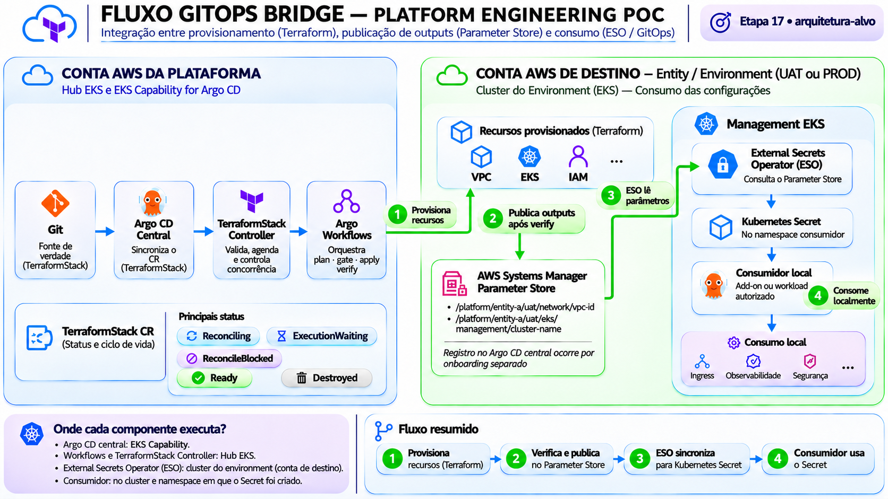

# GitOps Bridge Flow — Platform Engineering POC

[← Arquitetura](../architecture.md) · [GitOps Flow](gitops.md) · [TerraformStack Flow](terraformstack.md) · [Roadmap](../learning-roadmap.md)

> **Estado:** arquitetura-alvo documentada; integração ainda não implementada.  
> **Hoje:** o laboratório roda em `kind`; o `TerraformStack` da Etapa 05 possui contrato inicial, sem outputs AWS reais.  
> **Futuro:** Terraform publica outputs selecionados em AWS Systems Manager Parameter Store na **conta do Environment**; consumidores Kubernetes autorizados os utilizam por meio do External Secrets Operator (ESO).
>
> **Imagem:** o arquivo `gitops-bridge-flow.png` será adicionado manualmente nesta pasta. O desenho é **lógico**, não representa uma conexão de rede ou IAM já provisionada.



[Ver o diagrama em tamanho completo](./gitops-bridge-flow.png)

## 1. Objetivo

O **GitOps Bridge** conecta informações produzidas pela infraestrutura com as configurações consumidas por componentes Kubernetes, **sem exigir que o Argo CD leia o Terraform state** ou execute o provisionamento.

A responsabilidade é dividida em três processos:

1. **Produzir e publicar:** o fluxo TerraformStack provisiona a infraestrutura e publica apenas outputs selecionados e autorizados.
2. **Distribuir e consumir:** consumidores específicos leem os parâmetros na conta AWS correta; o ESO, quando usado, materializa informações como Kubernetes Secrets.
3. **Configurar e reconciliar:** aplicações e add-ons utilizam os dados por interfaces declarativas, conforme seu ownership.

**Fonte de verdade não significa armazenamento único:** Git define intenção, contratos e versões desejadas. O Parameter Store armazena **valores resultantes/dinâmicos**. O `TerraformStack.status` registra condições e referências de execução. Nenhum deles substitui o Terraform state.

## 2. Topologia e ownership

Na arquitetura AWS futura há pelo menos **duas fronteiras**: a conta de plataforma e a conta AWS do **Environment** da Entity. `entity-a/uat` e `entity-a/prod` representam contas AWS **distintas**, e o exemplo abaixo descreve **um Environment por vez**.

| Componente | Onde executa / reside | Ownership |
| --- | --- | --- |
| **Argo CD central, TerraformStack Controller e Argo Workflows** | Control Plane da plataforma: `kind` hoje, EKS de plataforma como evolução possível | Platform Team |
| **VPC, IAM, Management EKS, PCI e Non-PCI** | Conta AWS do Environment selecionado | Foundation / Entity Core, sob governança do Platform Team |
| **AWS SSM Parameter Store** | **Mesma conta e região autorizadas do Environment** para os parâmetros publicados nesse destino | Publicação governada pela plataforma |
| **External Secrets Operator para consumo de gestão** | **Management EKS do Environment**, quando esse cluster já existir | Instalação/configuração-base via Platform GitOps |
| **ESO de workloads (quando necessário)** | **EKS PCI ou Non-PCI** correspondente, sem compartilhamento automático entre clusters | Platform Team para instalação; consumidores autorizados para ExternalSecrets |
| **Kubernetes Secrets gerados pelo ESO** | Namespace do **cluster onde o ESO reconcilia** | Consumidor e políticas Kubernetes do cluster |
| **ApplicationSet corporativo** | **Argo CD central**, não no Management EKS apenas por haver ESO local | Platform Team |
| **Argo CD local** | Management EKS do Environment, ou capability gerenciada associada a ele na arquitetura AWS sob avaliação | Aplicações e extensões locais autorizadas |

**Regra:** o ESO **não é um serviço por conta AWS**. É um controller executando **dentro de um cluster Kubernetes**. Uma instância no Management EKS não distribui Kubernetes Secrets automaticamente para PCI, Non-PCI ou Control Plane.

Da mesma forma, **o ESO do Management não entrega automaticamente metadados ao ApplicationSet do Argo CD central**. São domínios Kubernetes distintos; o canal de integração precisaria ser explicitamente implementado e autorizado.

## 3. Fluxo principal: publicar outputs e consumi-los localmente

### 3.1 Provisionamento

```text
Git (TerraformStack) → Argo CD central → Kubernetes API
  → TerraformStack Controller → Argo Workflows
  → plan → política / aprovação → apply → verify
  → recursos na conta AWS de Entity / Environment
```

O processo completo de aprovação e status está documentado no [TerraformStack Flow](terraformstack.md). **Não criar uma segunda pipeline de Terraform dentro do Bridge.**

### 3.2 Publicação após verificação

Após um apply **autorizado e verificado**, uma etapa explícita de publicação:

1. Obtém os outputs permitidos do resultado daquela stack, sem conceder acesso irrestrito ao Terraform state.
2. Aplica um **contrato de exportação**: lista de nomes, formato, tipo, sensibilidade, versão e destino permitido.
3. Resolve conta/região pelo registro confiável `Entity + Environment` e confirma a identidade do destino.
4. Grava/atualiza parâmetros na **conta AWS de destino**, usando credenciais temporárias e IAM mínimo.
5. Publica evidências não sensíveis de sucesso/falha, versão e horário no contexto da execução.

Exemplo **ilustrativo** de caminhos:

```text
/platform/entity-a/uat/network/vpc-id
/platform/entity-a/uat/eks/management/cluster-name
/platform/entity-a/uat/eks/management/cluster-endpoint
/platform/entity-a/uat/iam/external-secrets-role-arn
```

Esses exemplos representam **metadados operacionais não secretos**. Não publicar state, plan binário, kubeconfig, tokens, senhas nem outputs classificados como sensíveis. Mesmo valores não secretos precisam de acesso restrito quando revelam topologia interna.

**Importante:** a **etapa de publicação** é uma capacidade adicional prevista, não algo que todo `terraform apply` execute hoje. Ela precisa de critérios de idempotência, reexecução, falhas parciais e política de limpeza.

### 3.3 Consumo no Management EKS

Depois de o Management EKS existir, o Platform GitOps instala o ESO com identidade e permissões adequadas, resolvendo o bootstrap sem dependência circular.

```text
Parameter Store (conta do Environment)
  → ESO no Management EKS (IAM autorizado)
  → ExternalSecret / SecretStore
  → Kubernetes Secret no Management EKS
  → consumidor LOCAL explicitamente configurado
```

O `SecretStore` aponta para o Parameter Store da conta e região corretas. A identidade do operador pode utilizar mecanismos AWS suportados, como **EKS Pod Identity / IRSA e/ou AssumeRole**, sujeitos ao desenho de segurança adotado.

O ESO reconcilia periodicamente o `ExternalSecret` com o provedor e atualiza o `Secret` de destino segundo a configuração. **Não implica atualização automática de um Helm value ou de uma ApplicationSet**: o consumidor precisa ler o Secret ou receber os metadados por um caminho declarativo suportado.

No PCI e no Non-PCI, instalar ESO **apenas se existir consumidor local** que o exija. Cada instância usa os limites de IAM e Kubernetes apropriados para seu cluster e classificação de segurança.

## 4. Dois caminhos de consumo — sem misturar controles

### A. Consumo local (padrão inicial recomendado)

Use ESO no **cluster em que o dado será consumido**:

- Um add-on ou Pod do Management EKS usa um Secret local.
- Um workload de PCI/Non-PCI utiliza um ESO/ExternalSecret **do próprio cluster**, se essa for a estratégia aprovada.
- O Git contém os `ExternalSecrets`, `SecretStores` e contratos declarativos, **não os valores sensíveis**.

Esse caminho **não depende** de o Argo CD central ler Secrets do Management EKS.

### B. Metadados para geração de Applications no Argo CD central (opcional)

O **Cluster Generator** do ApplicationSet lê **os clusters registrados no próprio Argo CD central** e seus metadados. Se um valor derivado do Terraform for realmente necessário para gerar Applications corporativas, é preciso:

1. Registrar e autorizar o cluster no Argo CD central, por um fluxo de onboarding próprio.
2. Publicar **somente metadados não sensíveis** no **registro central** que o Cluster Generator consulta, por um publisher/integração autorizada.
3. Selecionar a Application pela combinação de catálogo Git + labels e parâmetros de cluster; instalar os addons corporativos nos destinos permitidos.

**Não basta criar um Kubernetes Secret genérico no Management EKS.** Ele não será lido automaticamente pelo Cluster Generator central. O Secret de registro de cluster reconhecido pelo Argo CD é um objeto distinto, localizado no contexto do Argo CD que faz a descoberta.

Essa integração de metadados é **opcional**, requer desenho de segurança próprio e **não transfere o ApplicationSet corporativo para a entidade**. Os Platform Addons continuam sob ownership central; o Argo CD local mantém o ownership das aplicações e extensões autorizadas.

## 5. Onboarding é separado do GitOps Bridge

Os três passos são independentes:

| Operação | Mecanismo | Resultado |
| --- | --- | --- |
| **Provisionar** | TerraformStack + Argo Workflows | EKS e recursos AWS no Environment |
| **Registrar e autorizar** | Automação de onboarding | Cluster conhecido pelo Argo CD apropriado, com identidade, RBAC, destino e conectividade autorizados |
| **Configurar** | Argo CD + ApplicationSet + operadores locais | Add-ons e aplicações permitidos |

**Outputs no Parameter Store não registram clusters.** A conectividade de API Kubernetes, as EKS Access Entries/IAM, as labels de classificação e os limites PCI/Non-PCI devem ser estabelecidos explicitamente.

A avaliação do **EKS Argo CD Capability** para landing zones isoladas é uma decisão de implementação da arquitetura AWS, não pré-requisito para compreender este fluxo no laboratório `kind`.

## 6. Segurança e contratos de publicação

| Tema | Regra |
| --- | --- |
| **Allowlist de outputs** | Publicar somente chaves contratadas; proibir exportação genérica de `terraform output -json` para todos os parâmetros |
| **Sensibilidade** | Não expor credenciais nem tokens como annotations, labels ou parâmetros públicos; quando houver necessidade legítima de segredo, avaliar provedor/criptografia e política específicos |
| **IAM** | Publicador com escrita limitada ao prefixo e destino; ESO com leitura restrita aos parâmetros necessários |
| **KMS** | Se `SecureString` for usado, controlar chave e autorização de `kms:Decrypt`; acesso ao Parameter Store não basta automaticamente |
| **Isolamento** | `Entity + Environment` validado contra account/region reais; UAT e PROD com parâmetros e papéis separados |
| **Kubernetes** | Restringir `SecretStore`, `ExternalSecret`, Secrets, namespaces e service accounts por RBAC/admission policies |
| **Auditoria** | Correlacionar `TerraformStack`, revisão, Workflow, versão de output, parâmetro e resultado do consumidor |
| **Falhas** | Um `apply` correto pode coexistir com falha de publicação; refletir os resultados separadamente no status, sem falsificar `Ready` do consumidor |

**Observação:** o tipo `Secret` do Kubernetes **não torna seu conteúdo automaticamente criptografado ou inacessível**. O cluster precisa de controles adequados de acesso, criptografia em repouso e distribuição. O nome do componente External Secrets não autoriza replicar dados sensíveis para qualquer namespace.

## 7. Atualização, drift e remoção

**Mudança desejada via Git:** um novo `TerraformStack` produz novo plan e, após aprovação e verificação, pode publicar novos valores. Consumidores reconciliam as atualizações conforme seus intervalos e contratos.

**Drift detectado:** uma checagem sem apply **não deve sobrescrever parâmetros automaticamente** com valores externos não aprovados. Apenas um ciclo validado de reconciliação/publicação pode alterar o catálogo de outputs.

**Alteração externa no Parameter Store:** um valor mudado manualmente pode propagar-se ao consumidor; portanto, controles IAM, alertas e verificação de integridade são necessários. O Parameter Store **não é um mecanismo de aprovação** por si.

**Remoção/recriação de recurso:** retirar um parâmetro pode quebrar consumidores. A política deve prever dependências, tombstone/descontinuação quando aplicável, janela de migração e remoção explícita e autorizada. **Deletar `TerraformStack` não apaga automaticamente parâmetros e nem autoriza `terraform destroy`.**

**Idempotência:** republicar a mesma versão não pode provocar efeitos colaterais indevidos. Eventos duplicados, falhas parciais e parâmetros ausentes devem gerar sinais observáveis, não estados falsamente saudáveis.

## 8. Laboratório: kind primeiro, AWS depois

### Simulação local — sem recursos AWS

Objetivo: demonstrar o conceito produtor → distribuição → consumidor, sem depender de IAM ou EKS.

1. Simular o resultado verificado de uma execução Terraform (valores fictícios, não credenciais).
2. Manter um **store fictício de outputs** em ConfigMap ou fixture de teste, claramente rotulado como simulação de Parameter Store.
3. Publicar/atualizar um Secret **de demonstração**, por uma automação local; observar um consumidor Kubernetes reagir à alteração.
4. Alterar a versão do output e verificar a atualização; simular falha e parâmetro ausente.
5. Documentar que **isso não comprova a integração ESO + SSM real**. Um ensaio genuíno do ESO exigirá um provedor suportado, por exemplo um provedor local de teste ou a AWS na etapa correspondente.

### Integração AWS — quando o roadmap chegar ao destino

A evolução exige conta UAT autorizada, TerraformStack real, role de publicação, Parameter Store, cluster consumidor, ESO, RBAC e verificações. A escolha da etapa exata de implantação será feita **na revisão consolidada do roadmap**, após a documentação dos três fluxos.

Não antecipar contas, clusters ou custos AWS apenas para validar o desenho.

## 9. Critérios de aceite propostos

- O publicador grava **somente** os outputs allowlisted na conta/região autorizadas.
- UAT não consegue ler ou gravar parâmetros de PROD sem permissão explicitamente concedida.
- ESO do Management EKS lê e materializa o valor aprovado **somente no namespace de destino permitido**.
- Alterar um output propagado atualiza o consumidor conforme o contrato, com atraso de reconciliação mensurável.
- Um Secret local **não aparece automaticamente** no ApplicationSet central.
- O fluxo de registro de clusters funciona independentemente da publicação de outputs.
- Falhas de publicação, leitura, configuração, atualização e remoção são diferenciáveis e auditáveis.
- Nenhuma senha, token, kubeconfig, plan ou state aparece em Git, annotation, logs ou status.

## 10. Referências técnicas e arquiteturas publicadas

As referências abaixo fornecem **padrões e mecanismos verificáveis**; nenhuma implementa exatamente a arquitetura desta POC. **A combinação e as fronteiras de ownership documentadas aqui são decisões locais**, não atribuições a terceiros.

### Referências de implementação

| Fonte | Padrão aproveitado | Limite da analogia |
| --- | --- | --- |
| [AWS EKS Blueprints — Argo CD e GitOps Bridge](https://aws-ia.github.io/terraform-aws-eks-blueprints/patterns/gitops/gitops-getting-started-argocd/) | Bootstrap de EKS/add-ons com Terraform e Argo CD | O laboratório não adota integralmente o exemplo nem o mesmo backend de outputs |
| [AWS EKS Blueprints — Multi-Cluster Hub & Spoke](https://aws-ia.github.io/terraform-aws-eks-blueprints/patterns/gitops/gitops-multi-cluster-hub-spoke-argocd/) | Descoberta e distribuição de configurações entre clusters | Rede, identidade, PCI e landing zones exigem desenho próprio |
| [GitOps Bridge — projeto de referência](https://github.com/gitops-bridge-dev/gitops-bridge) | Conceito de transportar metadata Terraform até GitOps | Não assumir que o projeto usa nosso fluxo específico via Parameter Store |
| [AWS AppMod Blueprints — GitOps Bridge Architecture](https://github.com/aws-samples/appmod-blueprints/blob/main/docs/platform/gitops-bridge-architecture.md) | Cluster secrets, ApplicationSets e ESO em implantação de add-ons | É exemplo técnico, não uma garantia de adequação a todas as contas |
| [External Secrets Operator — AWS Parameter Store](https://external-secrets.io/latest/provider/aws-parameter-store/) | `ExternalSecret`/`SecretStore` e sincronização a partir do SSM | A leitura depende de cluster, namespace e identidade |
| [External Secrets Operator — AWS Access](https://external-secrets.io/latest/provider/aws-access/) | Autenticação com credenciais temporárias e roles AWS | IAM/Pod Identity/IRSA devem ser validados no ambiente real |
| [Argo CD — Cluster Generator](https://argo-cd.readthedocs.io/en/stable/operator-manual/applicationset/Generators-Cluster/) | Uso de labels/annotations dos **clusters registrados** | Não busca Secrets arbitrários em clusters remotos |
| [AWS — Hierarquia de parâmetros](https://docs.aws.amazon.com/systems-manager/latest/userguide/sysman-paramstore-hierarchies.html) | Prefixos e organização por Environment | Organização de paths não substitui IAM mínimo |
| [AWS — Restringir acesso a parâmetros](https://docs.aws.amazon.com/systems-manager/latest/userguide/ps-restrict-parameter-access.html) | Políticas de leitura e KMS | Particularidades de políticas hierárquicas precisam ser testadas |

### Contexto de adoção em plataformas

- [CNCF — Galaxy FinX: Kubernetes em mais de 100 clusters com Argo CD](https://www.cncf.io/case-studies/galaxy-finx/) — reforça a necessidade de automação e governança multicluster; **não é evidência de uso do mesmo Bridge**.
- [CNCF — Adobe: plataforma GitOps com Argo CD e Argo Workflows](https://www.cncf.io/case-studies/adobe/) — referência ao uso de múltiplos motores e controles de entrega; **não é descrição do nosso fluxo de outputs**.

## 11. Documentos relacionados

- [Arquitetura da POC](../architecture.md)
- [GitOps Flow](gitops.md)
- [TerraformStack Flow](terraformstack.md)
- [ADR-0006 — TerraformStack, status, aprovação e drift](../adr/0006-terraformrun-and-application-ci.md)
- [Roadmap](../learning-roadmap.md)

**Próxima atividade:** revisar em conjunto as 25 etapas e decidir onde entram o publisher de outputs, ESO, simulação local e validação AWS real. A documentação não altera o roadmap nem provisiona infraestrutura.
