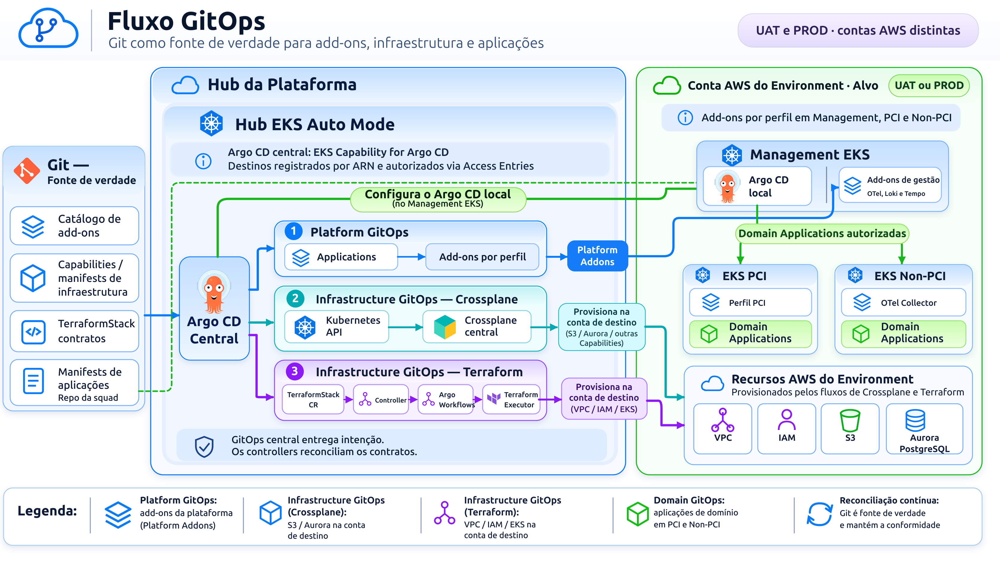

# GitOps Flow — Platform Engineering POC

> **Estado:** arquitetura-alvo aprovada (v1); implementação incremental conforme o roadmap.  
> **Atual:** Hub `kind` com bootstrap por scripts, Argo CD central e catálogo de add-ons.  
> **Futuro:** EKS, múltiplas entidades/ambientes e avaliação do EKS Argo CD Capability.

[Visualizar o diagrama em tamanho completo](./gitops-flow.png)

## 1. Objetivo e princípio

O **Git é a fonte de verdade das configurações desejadas**. Argo CD sincroniza manifests com as APIs Kubernetes; cada controller especializado é responsável por transformar a intenção em recursos e acompanhar seu estado. O desenho separa **como a intenção é entregue** de **como a infraestrutura ou a aplicação é reconciliada**.

O GitOps abrange quatro fluxos complementares:

| Fluxo | Entrada declarativa | Responsável pela execução/reconciliação | Resultado |
| --- | --- | --- | --- |
| **Platform GitOps** | Catálogo de add-ons e Applications | Argo CD central e ApplicationSet | Componentes Kubernetes corporativos |
| **Infrastructure GitOps — Crossplane** | CRs de Capabilities | Crossplane central e Provider AWS | S3, Aurora PostgreSQL e demais Capabilities |
| **Infrastructure GitOps — Terraform** | CR `TerraformStack` | TerraformStack Controller → Argo Workflows → Terraform Executor | Foundation, rede, IAM e EKS |
| **Domain GitOps** | Manifests de aplicações no repositório da squad | Argo CD local | Aplicações nos clusters PCI/Non-PCI autorizados |

> **Importante:** o diagrama é **lógico**, não prova de conectividade entre VPCs/landing zones nem de recursos AWS já implantados. O Argo CD central não executa diretamente Terraform nem substitui o Crossplane.

## 2. Bootstrap do Control Plane

### Hoje: Hub local com kind

O bootstrap inicial utiliza os scripts existentes de `platform/hub/scripts/` para criar o cluster, configurar Traefik e instalar Argo CD por Helm. O manifesto `platform/hub/addons/bootstrap.yaml` configura AppProjects e o ApplicationSet `hub-addons`, que lê **arquivos** de `platform/hub/addons/catalog/*.yaml`.

Cada entrada válida do catálogo gera uma Application própria. O laboratório inicialmente mantém **sincronização manual**, permitindo inspecionar diff e revisão. **Descoberta de Applications** pelo ApplicationSet e **auto-sync/self-heal** são controles distintos; não presumir que a descoberta já habilita a reconciliação automática.

O Argo CD não precisa estar instalado antes do script de bootstrap: o script estabelece o primeiro mecanismo GitOps, e o catálogo passa a entregar componentes subsequentes.

### Futuro: Hub na AWS

Terraform poderá provisionar o EKS do Control Plane e configurar seu mecanismo inicial de GitOps. O **EKS Argo CD Capability** é uma alternativa **sob avaliação**, sujeita a identidade, autorização cross-account, isolamento PCI, limites do serviço, rede e custo. Não é requisito dos laboratórios `kind`.

## 3. Platform GitOps — governança dos add-ons

O **Platform Team** mantém o padrão corporativo de componentes Kubernetes ao longo de seu ciclo de vida: instalação, atualização, configuração e reconciliação.

São exemplos de add-ons corporativos: Metrics Server, Karpenter, External Secrets Operator, logging, observabilidade, segurança e controllers da plataforma. Os **recursos AWS associados**, como IAM Roles e dependências de Karpenter, são provisionados pelo motor de infraestrutura designado, e não automaticamente pelo Helm Chart.

### Descoberta e seleção

- **Git Generator:** descobre as entradas versionadas do catálogo.
- **Cluster Generator:** seleciona clusters **registrados e autorizados** por labels e outras informações de destino.
- **Matrix Generator:** pode combinar os dois para gerar uma Application por combinação aprovada de componente e cluster.

O laboratório já possui **Git File Generator** no `hub-addons`; a seleção por clusters e a combinação Matrix fazem parte da evolução-alvo, não da implementação atual.

Perfis previstos:

| Perfil | Escopo de add-ons |
| --- | --- |
| **Control Plane** | Argo CD central, Argo Workflows, Crossplane e controllers centrais |
| **Management** | Argo CD local, componentes de gestão e telemetria |
| **PCI** | Add-ons corporativos explicitamente aprovados para PCI |
| **Non-PCI** | Add-ons corporativos do perfil padrão |

Cada cluster poderá receber labels como `entity`, `environment`, `cluster-role` e `compliance`. Essas labels são **metadados de seleção**, não mecanismo de autorização por si sós. O onboarding estabelece previamente acesso, identidade, RBAC e confiança do cluster.

**Overrides por Entity/Environment** são permitidos quando definidos e aprovados pelo Platform Team. A customização de parâmetros não transfere o ownership do add-on corporativo.

## 4. Infrastructure GitOps — Crossplane

1. O DevOps Federado propõe a criação/alteração de uma **Capability aprovada** por PR.
2. O Argo CD central sincroniza o CR correspondente na API Kubernetes do Hub.
3. O Crossplane central observa o recurso, aplica XRD/Composition e utiliza Provider AWS e identidade autorizada.
4. O Crossplane cria/atualiza e continua reconciliando os recursos AWS; suas condições e status indicam o resultado.

As duas primeiras Capabilities do roadmap são **`ObjectStorage` (S3)** e **`Database` (Aurora PostgreSQL)**. Crossplane não precisa executar um Terraform Workflow para reconciliá-las. **`Synced` no Argo CD confirma a entrega do manifesto, não necessariamente o recurso AWS pronto.**

## 5. Infrastructure GitOps — TerraformStack

1. O Platform Team (ou persona autorizada) propõe um `TerraformStack` em Git.
2. Após validação e revisão, o Argo CD central sincroniza **o CR de intenção** no Hub.
3. O **TerraformStack Controller** valida módulo, revisão, Entity/Environment e destino confiável; avalia quando iniciar uma execução.
4. O **Argo Workflows** orquestra `plan`, política, aprovação humana quando exigida e `apply` pelo Terraform Executor.
5. O Terraform provisiona a infraestrutura; o controller verifica a execução e atualiza `TerraformStack.status`.

**Não há `terraform apply` em todo reconcile da API Kubernetes.** A Etapa 09 introduz a execução real com aprovação vinculada ao plano; a Etapa 18 introduz a detecção periódica de drift; e a Etapa 19 introduz políticas de remediação automática, aprovação obrigatória ou bloqueio.

Remover o CR do Git **não autoriza destroy automático**. Os detalhes de concorrência, plano imutável, aprovação, estado e retry estão no [ADR-0006](../adr/0006-terraformrun-and-application-ci.md) e serão aprofundados em `docs/flows/terraformstack.md`.

## 6. Domain GitOps — aplicações das entidades

Cada **Environment** da Entity possui, na topologia-alvo, três clusters: **Management**, **PCI** e **Non-PCI**.

O Argo CD **central** instala e mantém a configuração-base do **Argo CD local** no Management Cluster, quando esse modelo for autorizado. O Argo CD **local** gerencia as Applications das squads nos clusters PCI e Non-PCI permitidos, além de extensões locais não conflitantes e expressamente autorizadas.

A squad mantém **código, testes, pipeline CI/CD e manifests Kubernetes em repositório próprio**, separado do monorepo da POC. O CI publica uma imagem e propõe uma mudança declarativa de versão. Após revisão, o Argo CD local sincroniza a aplicação; a pipeline não realiza deployment imperativo como caminho padrão.

**Nenhum recurso Kubernetes pode ser administrado pelos dois Argo CDs simultaneamente.** Os limites são aplicados por AppProjects, RBAC, admission policies, permissões de repositório e identidades. Em particular, Argo CD local não administra os add-ons corporativos cujo owner é o Argo central.

## 7. Reconciliação, segurança e drift

| Tipo de recurso | Quem detecta divergência | Comportamento |
| --- | --- | --- |
| Componentes Kubernetes corporativos | Argo CD central | Detecta OutOfSync; `selfHeal` corrige quando habilitado e autorizado |
| Domain Applications | Argo CD local | Sync e rollback conforme políticas de aplicação |
| Capabilities AWS | Crossplane | Reconciliação contínua conforme configuração/provider |
| Foundation e EKS via Terraform | TerraformStack Controller + Terraform | Plan/avaliação de drift e remediação conforme política |

**GitOps não substitui controles preventivos.** IAM, RBAC, admission, segregação PCI/Non-PCI, revisão de PR e autorização de destinos continuam obrigatórios.

## 8. Onboarding dos clusters

O onboarding futuro tem três operações independentes:

1. **Provisionar:** TerraformStack cria EKS e suas dependências AWS.
2. **Registrar e autorizar:** automação estabelece identidade, permissões, endpoint/acesso e labels do destino no Argo CD apropriado. **Publicar outputs no Parameter Store, por si só, não registra o cluster.**
3. **Configurar:** ApplicationSet identifica o cluster autorizado e gera Applications para os perfis aprovados.

As landing zones podem ser isoladas, sem VPC Peering nem Transit Gateway. O padrão GitOps não deve pressupor conectividade irrestrita. A escolha entre Argo CD autogerenciado, acesso privado específico e EKS Argo CD Capability permanece sujeita à validação da arquitetura AWS.

## 9. Limites e GitOps Bridge

Git define **configuração e intenção declarativas**; não é obrigatório armazenar nele outputs dinâmicos, credenciais ou Terraform state.

O [GitOps Bridge Flow](gitops-bridge.md) documenta separadamente: publicação de outputs selecionados do Terraform no Parameter Store, consumo por External Secrets Operator e, quando aplicável, parâmetros de ApplicationSet. Também serão tratados atualização, revogação e limpeza de parâmetros, sem exposição de segredos em annotations.

## 10. Implementação incremental

| Etapa | Evidência principal |
| --- | --- |
| 01–02 | Bootstrap kind, Argo CD central e catálogo de Applications |
| 03–05 | Argo Workflows, Crossplane Core e CRD TerraformStack |
| 06 | Controller e Terraform Executor simulado |
| 07–09 | Environment UAT, IAM/backend e primeiro plano/aplicação aprovados |
| 10–12 | EKS Management, Non-PCI, Argo local e smoke test da aplicação |
| 13–15 | Providers e Capabilities AWS |
| 18–20 | Drift, remediação por políticas e isolamento |
| 23–24 | Integração completa de Domain Infrastructure e Domain Applications |

Os laboratórios iniciais permanecem em **kind**; adicionar dependências AWS antes da etapa correspondente não faz parte desta aprovação.

## 11. Princípios arquiteturais

1. Git é a fonte de verdade da **intenção aprovada**.
2. Argo CD sincroniza contratos; motores especializados reconciliam seus respectivos domínios.
3. Os add-ons corporativos pertencem permanentemente ao Platform Team.
4. Aplicações e extensões locais autorizadas têm lifecycle independente.
5. Cada recurso Kubernetes possui **um único owner de reconciliação**.
6. Bootstrap, registro de cluster, configuração e operação são atividades distintas.
7. `Synced` na API Kubernetes não implica infraestrutura AWS convergida.
8. O desenho lógico deve poder evoluir do kind para EKS preservando os contratos.

## 12. Documentos relacionados

- [Arquitetura principal](../architecture.md)
- [Roadmap](../learning-roadmap.md)
- [TerraformStack Flow](terraformstack.md) · [GitOps Bridge Flow](gitops-bridge.md)
- [ADR-0003 — Reconciliação e GitOps](../adr/0003-reconciliation-and-gitops.md)

## 13. Referências externas — conceitos aplicados

Estas fontes fundamentam **princípios específicos**; não reproduzimos integralmente a arquitetura de nenhuma delas.

| Referência | Conceito aplicado na POC |
| --- | --- |
| [RELEX Solutions — *Where State Meets Sync*, PlatformCon 2026](https://2026.platformcon.com/sessions/where-state-meets-sync-scaling-platforms-without-the-hype) | **Separação de responsabilidades:** Terraform cuida da infraestrutura, enquanto Argo CD mantém um ciclo GitOps independente para aplicações e componentes. Foi a inspiração inicial do fluxo. |
| [AWS EKS Blueprints — Multi-Cluster Hub & Spoke](https://aws-ia.github.io/terraform-aws-eks-blueprints/patterns/gitops/gitops-multi-cluster-hub-spoke-argocd/) | **Distribuição declarativa multicluster:** Argo CD e ApplicationSets para selecionar e instalar add-ons em destinos diferentes. A POC adapta o padrão ao ownership corporativo e aos limites entre contas. |
| [Adobe — case CNCF sobre Argo](https://www.cncf.io/case-studies/adobe/) | **GitOps como capacidade de plataforma:** práticas padronizadas e composição de ferramentas Argo para entrega governada em escala. Não implica que a Adobe utilize nossa topologia ou o `TerraformStack`. |

**Nota:** os contratos, a divisão central/local e as políticas PCI desta POC são decisões próprias, a serem validadas nos laboratórios.
