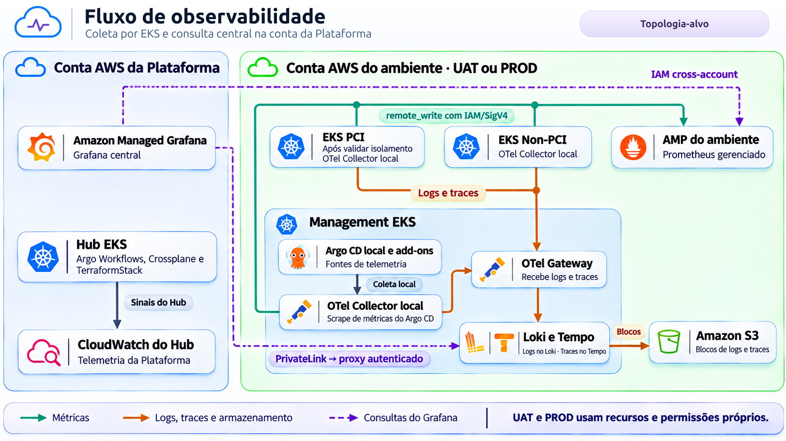

# Fluxo de observabilidade

[← Arquitetura](../architecture.md) · [ADR-0010](../adr/0010-observability-topology.md) · [Observability Plane](../../observability-plane/README.md) · [Padrões em avaliação](../../README.md#padrões-em-avaliação)

O fluxo descreve a **topologia-alvo da POC**. O TerraformStack já expõe sinais operacionais no ensaio inicial do Simulator. A coleta, os backends e a consulta central entram nas Etapas 26–27, começando por Management e Non-PCI em UAT. O diagrama mostra uma conta de Environment por vez. UAT e PROD seguem o mesmo modelo com recursos e permissões próprios.

[Abrir diagrama em tamanho completo](observability-flow.png)

## Caminhos de ingestão e consulta

| Origem | Métricas | Logs e traces |
| :--- | :--- | :--- |
| EKS Non-PCI | OTel Collector local → AMP do ambiente via `remote_write` | OTel Collector local → OTel Gateway do Management EKS |
| EKS PCI, após validação do isolamento | OTel Collector local → AMP autorizado | OTel Collector local → Gateway autorizado |
| Management EKS | OTel Collector local → AMP do ambiente, incluindo o scrape do Argo CD local | OTel Collector local → Gateway no próprio cluster |
| Hub da Plataforma | Métricas operacionais essenciais → CloudWatch do Hub | Logs e demais sinais operacionais aplicáveis → CloudWatch do Hub |

A Etapa 26 valida quais sinais do Hub chegam ao CloudWatch e como correlacioná-los com os Events na API Kubernetes. Os Events continuam disponíveis para inspeção na API conforme a retenção do cluster.

O Gateway encaminha logs ao **Loki** e traces ao **Tempo**. Os dois backends rodam no Management EKS e persistem seus blocos no S3 do ambiente. Traces entram quando o componente estiver instrumentado e configurado para exportá-los. O Grafana consulta o AMP para métricas e as APIs de Loki e Tempo para logs e traces. O S3 armazena os blocos dos backends. A consulta passa pelas APIs de leitura de Loki e Tempo. Os Collectors usam `remote_write` com IAM/SigV4 para enviar métricas ao AMP, inclusive no Management EKS.

No Management EKS, por exemplo, o Argo CD local expõe métricas Prometheus de saúde e sincronização. O Collector faz o scrape e envia as séries diretamente ao AMP. O AMP armazena e disponibiliza séries para consulta, portanto o scrape pode funcionar com o Collector e sem um servidor Prometheus autogerenciado no cluster. [Métricas do Argo CD](https://argo-cd.readthedocs.io/en/stable/operator-manual/metrics/) · [Ingestão de métricas no AMP](https://docs.aws.amazon.com/prometheus/latest/userguide/AMP-ingest-methods.html)

## Fronteiras e ownership

| Recurso | Responsabilidade |
| :--- | :--- |
| Collectors, Gateway, Loki e Tempo | Platform Team define configuração e distribuição de add-ons por perfil via Argo CD central. |
| AMP, S3, conectividade privada, Grafana e IAM | Platform Team provisiona os recursos AWS declarativamente por Terraform e concede acessos por origem e destino. |
| Instrumentação da aplicação | A squad instrumenta código e configura a exportação no próprio repositório. Argo CD local entrega os manifests nos clusters autorizados. |
| Alertas e dashboards | A plataforma mantém o baseline de coleta, saúde e falhas de ingestão. As squads definem os sinais da aplicação e os limites operacionais do seu Domain. |

O Managed Grafana usa uma conexão à VPC da Plataforma para alcançar, via PrivateLink, as APIs privadas de leitura de cada ambiente. O desenho prevê interface endpoint na VPC do Hub e endpoint service com NLB e proxy autenticado na VPC do ambiente. O proxy limita o acesso a Loki e Tempo. O Grafana consulta o AMP pela API AWS, com IAM cross-account. Validar DNS, TLS, permissões, conectividade aos endpoints AWS e acesso por datasource na Etapa 26. [Conectividade VPC do Grafana](https://docs.aws.amazon.com/grafana/latest/userguide/AMG-configure-vpc.html) · [Serviços via PrivateLink](https://docs.aws.amazon.com/vpc/latest/privatelink/privatelink-share-your-services.html)

Atribuir Entity, Environment, cluster e serviço aos sinais de forma consistente. Para diagnóstico, correlacionar estado e Events da API Kubernetes com a revisão Git, a aplicação Argo CD, a execução do Workflow e as condições do Crossplane. Aplicar políticas de conteúdo e acesso antes da ingestão e testar consulta com identidades de escopos distintos. Excluir credenciais, dados sensíveis, conteúdo de planos e state da telemetria. Preferir dimensões de cardinalidade controlada para métricas.

## Critérios de aceite

| Etapa | Evidência esperada |
| :--- | :--- |
| **26 — UAT** | Gerar métrica, log e trace correlacionáveis a partir de uma aplicação Non-PCI. Consultar os três no Grafana. Confirmar que métricas do Argo CD local chegam ao mesmo AMP via o Collector do Management EKS. Conferir que os sinais essenciais do Hub podem ser consultados no CloudWatch. |
| **27 — Falha controlada** | Interromper o Gateway em UAT. Confirmar no AMP amostras dos workloads com horário posterior ao início da falha. Gerar logs e traces identificáveis durante a interrupção e confirmar o alerta de um check fora do Management EKS. Após a recuperação, medir a fila entregue e a perda. Registrar custo de ingestão, consulta e armazenamento. |
| **30 — PCI, quando autorizado** | Testar acesso à ingestão e consulta com identidades PCI e Non-PCI. Confirmar que acessos indevidos são negados no backend e que permissões na fonte de dados refletem a fronteira aprovada. |
| **31 — PROD, quando provisionado** | Validar workspaces, armazenamento, identidade e consultas segregadas. Repetir a falha controlada em UAT e confirmar continuidade dos sinais de PROD. |

Na falha isolada do Gateway, Loki e Tempo podem continuar servindo consultas existentes enquanto os backends permanecem saudáveis. Se todo o Management EKS ficar indisponível, Loki e Tempo também deixam de servir consultas temporariamente. Os blocos já persistidos ficam no S3, e o AMP continua recebendo métricas dos workloads cujos Collectors seguem operacionais. A recuperação da fila depende da configuração e da capacidade do Collector. Testar persistência se o aceite exigir entrega após reinício do Collector. [Resiliência dos Collectors](https://opentelemetry.io/docs/collector/resiliency/) · [Permissões de datasources no Managed Grafana](https://docs.aws.amazon.com/grafana/latest/userguide/data-source-permissions.html)

[← Arquitetura](../architecture.md) · [Etapas de observabilidade e operação](../learning-roadmap.md#fase-6--observabilidade-operação-e-governança)
