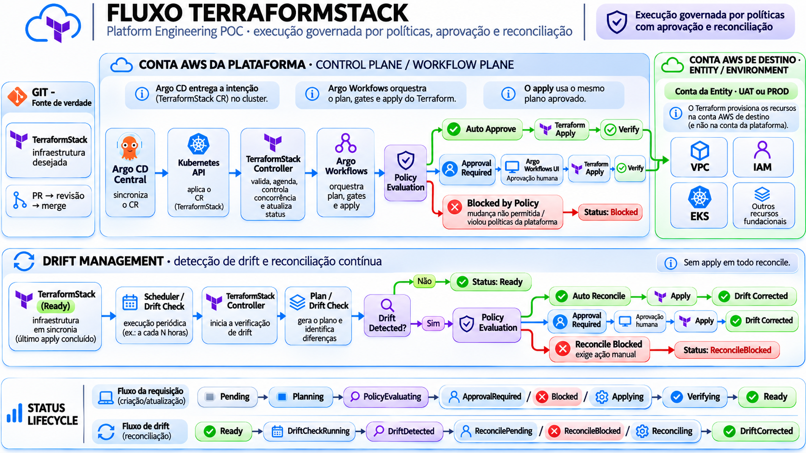

# TerraformStack Flow — Platform Engineering POC

[← Arquitetura](../architecture.md) · [GitOps Flow](gitops.md) · [ADR-0006](../adr/0006-terraformrun-and-application-ci.md) · [Roadmap](../learning-roadmap.md)

> **Nota sobre status:** os nomes de estados apresentados neste documento descrevem o **lifecycle lógico esperado**, não campos ou enums já implementados no CRD. O schema atual expõe `status.conditions`; a estrutura definitiva de `phase`, condições e referências será consolidada durante a implementação do controller.

## 1. Visão geral

O `TerraformStack` representa **infraestrutura desejada**, e não uma execução isolada de Terraform. Seu propósito é integrar provisionamento, atualização, verificação de drift e reconciliação governada ao modelo declarativo da plataforma.

O Git mantém a intenção versionada; Argo CD sincroniza o objeto Kubernetes; o TerraformStack Controller governa seu lifecycle; Argo Workflows orquestra plan, gates e apply; Terraform modifica recursos na **conta AWS de destino**.



[Visualizar o diagrama em tamanho completo](./terraformstack-flow.png)

### Resumo do caminho principal

```text
Git / PR revisado
  → Argo CD central
  → Kubernetes API / TerraformStack (CR)
  → TerraformStack Controller
  → Argo Workflows (plan, policy, gate, apply)
  → [Auto Apply | Approval Required | Deny/Block]
  → Terraform Apply (quando autorizado)
  → Verify
  → TerraformStack.status
  → AWS na conta da Entity / Environment autorizado
```

Há **dois gatilhos operacionais**: (a) criar/alterar a intenção por Git; (b) verificar periodicamente uma stack existente ou solicitar nova verificação controlada. Ambos passam por validações; qualquer alteração efetiva exige uma decisão de política e autorização adequadas.

## 2. Responsabilidades e fronteiras

| Componente | Responsabilidade |
| --- | --- |
| **Git / PR** | Definir versão do módulo, configuração e destino lógico aprovados; manter auditoria de alterações desejadas |
| **Argo CD central** | Entregar o **CR** `TerraformStack` do Git à API Kubernetes do Hub; não executar Terraform |
| **Kubernetes API** | Validar o objeto segundo o CRD e disponibilizar `spec` e `status` |
| **TerraformStack Controller** | Observar mudanças, resolver o destino autorizado, evitar concorrência, coordenar execuções e atualizar status |
| **Argo Workflows** | Orquestrar plan, avaliação de política, pausa para aprovação, apply e verificação |
| **Terraform / executor do Workflow** | Calcular e aplicar mudanças usando identidade temporária, backend e módulo autorizados |
| **Policy Engine (previsto)** | Classificar cada plano em **Auto Apply**, **Require Approval** ou **Deny/Block** |
| **Backend de state e artefatos** | Armazenar state/lock e planos imutáveis em local privado, fora do Git |
| **AWS de destino** | Hospedar VPC, IAM, EKS e demais recursos provisionados para a Entity / Environment |

**Fronteiras AWS:** a conta da plataforma hospeda os componentes de controle/execução quando migrarmos do `kind`. Cada Environment (`uat`, `prod`) corresponde a uma **conta AWS de destino distinta** da Entity. Uma stack resolve a conta/região/role por um cadastro confiável; o usuário **não escolhe livremente credenciais ou account IDs por manifesto**.

**Separação CRD e CR:** a Etapa 05 registra o tipo `TerraformStack` na API por meio do CRD. Nos fluxos operacionais, o Argo CD sincroniza **instâncias** desse tipo. O controller da Etapa 06 passa a observá-las.

## 3. Contrato declarativo

A definição inicial está em `control-plane/terraformstack/crd/terraformstack.yaml`, com API `platform.example.io/v1alpha1` e escopo `Namespaced`.

Exemplo da Etapa 05 (dados fictícios):

```yaml
apiVersion: platform.example.io/v1alpha1
kind: TerraformStack
metadata:
  name: network-uat
  namespace: platform-system
spec:
  sourceRef:
    name: foundation-stacks
    path: stacks/lab-network
    version: "1.0.0"
  target:
    entity: entity-a
    environment: uat
```

O CRD atual também oferece `configuration.revision` e os controles declarativos adicionais. O executor real será estendido nas etapas correspondentes para **resolver e fixar** versão de source/config, identidade e backend, e executar o lifecycle governado. **O exemplo acima não implica execução AWS** enquanto o controller e as dependências não estiverem implementados.

Os valores de módulos previstos em `config/` têm precedência **global → Entity → Environment**. O destino AWS real é resolvido a partir de `foundation/config/<entity>/<env>/environment.yaml`; Git e Terraform state não devem conter credenciais.

`TerraformRun` fica reservado como eventual nome de uma execução individual. Por enquanto, um Argo Workflow é suficiente para representar cada execução: **não criar um segundo CRD sem necessidade**.

### 3.1 Dependências e intervalo de drift — evolução do contrato

A arquitetura passa a prever dois recursos inspirados em controladores de infraestrutura existentes: **dependências explícitas entre stacks** e **intervalo configurável para verificação periódica**. Eles serão adicionados ao schema somente nas etapas de implementação correspondentes. **Os campos já foram adicionados ao CRD v1alpha1, mas os comportamentos continuam planejados para as etapas correspondentes.**

Exemplo **conceitual**, ainda não aplicável ao CRD:

```yaml
spec:
  dependsOn:
    - name: network-uat
  reconciliation:
    driftCheckInterval: 6h
```

- **`dependsOn`:** antes de iniciar um novo plan/apply de `eks-management-uat`, o controller verifica que `network-uat` está `Ready` para sua `observedGeneration` atual. Dependências devem ser referenciadas por nome estável, resolvidas e autorizadas; o padrão inicial limita a referência ao mesmo namespace e `Entity/Environment`. Referências ausentes, não prontas e ciclos bloqueiam a execução com condição/motivo observável. Uma mudança de dependência pode reavaliar a stack dependente, mas **não autoriza apply automático**.
- **`driftCheckInterval`:** define a frequência desejada de **verificação**, não de aplicação. O controller agenda a próxima checagem apenas para stacks elegíveis, com agendamento persistente, dispersão (*jitter*) e deduplicação; uma checagem sobre state ocupado não inicia execução concorrente. Expor última/próxima checagem e resultado em status, sem dados sensíveis.
- **Gatilhos distintos:** alteração declarada no Git, solicitação manual autorizada por annotation e checagem periódica. Reconcile do Kubernetes não executa Terraform indiscriminadamente.
- **Etapas:** `dependsOn` está previsto para o provisionamento sequenciado dos EKS nas Etapas 10–11; `driftCheckInterval` entra com verificação real na Etapa 24 e continua sujeito à política da Etapa 25.


### 3.2 Evolução do contrato: sourceRef, destroy e controles operacionais

A POC **mantém** o CRD genérico `kind: TerraformStack`, o controller próprio e Argo Workflows. As propriedades a seguir são **contrato já aceito no schema v1alpha1**, porém **não são funcionalidades implementadas** no controller do laboratório 06. Não copiar o CRD do Tofu Controller nem criar dependência obrigatória de Flux.

```yaml
apiVersion: platform.example.io/v1alpha1
kind: TerraformStack
metadata:
  name: network-uat
spec:
  target:
    entity: entity-a
    environment: uat
  sourceRef:
    name: foundation-stacks     # fonte do catálogo aprovada
    path: stacks/network        # raiz da stack, pode compor vários módulos
    version: "1.2.3"          # opcional; omitido significa latest
  configuration:
    revision: "<config-commit-sha>" # opcional; omitido significa latest
  dependsOn: []
  suspend: false
  reconciliation:
    driftCheckInterval: 6h
    retryPolicy:
      strategy: ExponentialBackoff
      interval: 5m
      maxInterval: 1h
  lifecycle:
    destroy: false
    destroyResourcesOnDeletion: false
```

**Regras de sourceRef:** a referência lógica é resolvida em catálogo confiável de fontes de stacks, com repositório Git/OCI e revisões permitidos; o consumidor não escolhe URL arbitrária, credenciais, módulos fora do catálogo ou caminho que escape do diretório permitido. `path` identifica a raiz da **stack completa** (por exemplo, Network ou EKS), não um único módulo Terraform. `version` é opcional: ausente ou `latest` seleciona a versão mais recente **permitida pelo catálogo**, mas o executor deverá resolvê-la uma única vez para um commit/digest imutável por Workflow. Para Git, tag/ref também deve ser resolvida a commit; para Registry, versão publicada a um artefato verificável. O formato legado `spec.module.name/version` continua aceito pelo CRD como alternativa a `sourceRef`, **nunca simultaneamente**. A simulação da Etapa 06 aceita ambos; a execução real ainda precisará resolver fontes Git/Registry e fixar a versão/commit antes do plan. `configuration.revision` fixa separadamente os YAMLs hierárquicos daquela execução. Ainda não está decidido se a fonte usará uma referência de catálogo interna ou um objeto Kubernetes dedicado; nenhuma integração Flux é presumida.

**Lifecycle e controles propostos:**

| Campo | Significado | Garantia |
| --- | --- | --- |
| `spec.lifecycle.destroy` | Intenção explícita de destruir recursos gerenciados pela stack **sem exigir a exclusão imediata do CR** | Gera `plan -destroy -out`, decisão de política, aprovação humana obrigatória e apply do mesmo plano; o status registra progresso/resultado |
| `spec.lifecycle.destroyResourcesOnDeletion` | Intenção de executar cleanup ao excluir o CR | **Default `false`**. Se `true`, um finalizer pode coordenar destroy **apenas quando autorizado pela política e por um fluxo de aprovação verificável**. A exclusão do Git/CR **não constitui aprovação** |
| `spec.suspend` | Pausar agendamento de **novas** execuções e drift checks | Não interrompe um apply já iniciado nem revoga autorizações já concedidas; alterações e retomada devem ser auditadas |
| `spec.reconciliation.retryPolicy` | Frequência e estratégia de retries após **falhas operacionais** | Retry não reaplica um plano vencido, não reaproveita aprovação, não ignora `Denied` ou rejeição humana |
| `spec.reconciliation.driftCheckInterval` | Frequência de `plan` para drift | **Não** é frequência de apply nem autoriza remediação automática |
| `healthChecks` (futuro) | Verificação de readiness de outputs/recursos após o apply | Não substituir checks operacionais básicos do próprio Workflow |

**Destroy na exclusão é um caso distinto de `destroy: true`.** Se o recurso já está em `deletionTimestamp`, a configuração/approval não deve depender de editar novamente o `spec` desse objeto. O controller precisa preservar um snapshot imutável da solicitação de remoção, origem, estado, referências de source/config, destino e plano; a aprovação ocorre em mecanismo auditável separado (Argo Workflows UI, com confirmação de identidade e autorização). O finalizer impede a remoção enquanto houver teardown autorizado em curso. Um `Deny`, perda de dependência, source/state inacessível ou ausência de aprovação **bloqueia** o destroy e exige intervenção operacional autorizada; não remover automaticamente o finalizer como atalho nem executar destroy sem gate. Para evitar CRs permanentemente presos, uma eventual operação de **orphan/retain** deve ter política e auditoria próprias. Não são garantias que o Tofu Controller ofereça automaticamente: são exigências **do nosso** controller.

**Proteção de dependências:** antes de destruir Network, impedir a operação se houver EKS ou outra stack dependente ativa e não descomissionada. Exigir plano de desativação em ordem reversa, mantendo locks de state separados e referências válidas até o final. No destroy explícito, manter o CR/status até concluir e permitir retry autorizado ou recuperação de falha; nova intenção de criação deve ser tratada por um ciclo controlado.

**Campos que não exporemos inicialmente:** seleção livre de `serviceAccountName`, AWS Role ARN, backend, `forceUnlock`, `targets` e credenciais no manifesto. São poderes de execução ou operações de recuperação sensíveis; permanecem na configuração administrada da plataforma e em operações privilegiadas, nunca como bypass de política. Variáveis e feature flags vêm preferencialmente do módulo Configuration e de sua revisão aprovada.

**Sequência:** o schema e o simulador da Etapa 06 já aceitam a referência e a suspensão, sem resolução real de versões nem execução AWS; utilizar `sourceRef` imutável nas stacks Network/EKS; construir o fluxo real de `plan -destroy`, finalizer, autorização, tratamento de dependências e recuperação na **Etapa 25**, junto ao motor de políticas. `driftCheckInterval` real permanece na **Etapa 24**. Para usar destroy em cleanup de laboratório antes da Etapa 25, recorrer a procedimento **manual e explicitamente autorizado**, fora da reconciliação automática do CR.

Referências externas: [Tofu Controller API](https://flux-iac.github.io/tofu-controller/References/terraform/) · [Destroy on deletion](https://flux-iac.github.io/tofu-controller/use-tf-controller/provision-resources-and-destroy-them-when-terraform-object-gets-deleted/).

## 4. Fluxo A — provisionamento e mudança desejada

1. O Platform Team ou um solicitante autorizado altera o manifesto `TerraformStack` e, quando aplicável, a configuração versionada, submetendo PR.
2. Validações de schema, política e ownership antecedem o merge. **A aprovação do PR não substitui a aprovação do plano Terraform.**
3. O Argo CD central sincroniza o CR com a API Kubernetes. `Synced` comprova a entrega do manifesto, **não** que a AWS esteja convergida.
4. O TerraformStack Controller identifica a `generation`/revisão, valida módulo, destino, permissões, estado da stack e concorrência, e inicia o Workflow adequado.
5. Argo Workflows gera um `terraform plan`, registra seu resumo e o submete à avaliação de políticas.
6. A política determina **aplicação permitida**, **aprovação humana obrigatória** ou **bloqueio**.
7. Somente em caminho autorizado, o Workflow aplica **o mesmo plano validado/aprovado**, verifica o resultado e atualiza `TerraformStack.status`.

A execução é **event-driven e governada**; um reconcile do Kubernetes não deve gerar `terraform apply` indiscriminadamente. A implantação inicial do controller poderá simular esse fluxo sem realizar chamadas AWS.

### 4.1 Três caminhos após Policy Evaluation

| Decisão | Quando | Próximo passo | Resultado esperado |
| --- | --- | --- | --- |
| **Auto Apply** | Regra versionada permite explicitamente a ação, o destino e o risco | Apply → Verify | `Ready` quando validado |
| **Require Approval** | Mudança sensível ou política exige análise humana | Pausa no Argo Workflows → aprovação vinculada ao plano → Apply → Verify | `Ready` ou falha documentada |
| **Deny / Block** | Operação proibida, destino inválido ou violação de política | **Não executar apply** | `Blocked` com motivo verificável |

**Limite do roadmap:** até a Etapa 09, todo `apply` real exige **aprovação humana**. A decisão automática passa a ser implementada/validada somente na **Etapa 25**, com regras explícitas e testadas; o desenho mostra a **arquitetura-alvo**, não um Auto Apply já liberado.

Exemplos ilustrativos de decisão:

- **Auto Apply (futuro):** alteração de tag permitida em UAT, após verificação da política e do impacto.
- **Require Approval:** alteração de rede sensível, mudanças de maior risco ou operações definidas como críticas.
- **Deny / Block:** destino não autorizado, recurso fora dos padrões, exposição insegura ou operação proibida.

Ao bloquear, a plataforma deve retornar uma explicação concreta, como `PolicyViolation: alteração não permitida para o Environment solicitado`, com identificação da regra. **Bloqueio por política não é a mesma coisa que rejeição humana**, e os dois motivos devem permanecer distintos na auditoria.

### 4.2 Approval Gate — plano imutável

O canal escolhido é a **Argo Workflows UI**, com `suspend: {}` e autenticação/autorização individual para os aprovadores. Não há prazo fixo de aprovação configurado no `suspend` nesta fase.

A aprovação deve ficar vinculada à **identidade do aprovador**, Workflow, hash do plano, geração do CR, revisão Git/configuração, conta/região, backend/state e identidade do destino. O arquivo binário de plano fica em armazenamento privado e possui validade operacional controlada.

Após o `resume`, um passo separado valida a autorização, os vínculos e o estado atual antes de executar `terraform apply <plano>`. Um simples `resume` não é evidência suficiente. Se a validação falhar, não há apply: gera-se novo plano e exige-se nova decisão.

**Aprovação humana pode permanecer pendente sem um timer de expiração do Workflow; isso não implica que um plano antigo ou inválido possa ser aplicado.** A revalidação e a política de validade do artefato continuam obrigatórias.

### 4.3 Executor por Pods do Argo Workflows e identidade AWS

**Não criar outro Runner Controller.** O TerraformStack Controller inicia um `Workflow` a partir de um `WorkflowTemplate` governado; Argo Workflows cria Pods efêmeros para passos como `plan`, avaliação de política, revalidação, `apply` e verificação. Uma imagem **Terraform Executor** contém a CLI e os utilitários necessários. O Argo coordena execução e artefatos, mas **não resolve sozinho as permissões AWS**.

```text
TerraformStack (entity-a/uat)
  → Controller: módulo, dependências, destino autorizado e geração
  → Argo Workflow (ServiceAccount Kubernetes restrita)
      → Pod: plan        → identidade temporária UAT → plan imutável
      → Pod: policy      → Auto Apply / Require Approval / Deny
      → suspend          → decisão humana, se exigida
      → Pod: revalidate  → plano/aprovação/state/destino/generation
      → Pod: apply       → nova identidade temporária UAT → aplicar o MESMO plano
      → Pod: verify      → status e evidências
      → publisher        → outputs permitidos (GitOps Bridge, Etapa 13)
```

O `serviceAccountName` do Workflow define a **identidade Kubernetes dos Pods**, e não a role AWS de destino. É necessário separar três responsabilidades:

1. **Controller:** possui RBAC para criar/acompanhar Workflows, não credenciais de alteração da conta de destino.
2. **Workflow/Executor:** usa Kubernetes ServiceAccount reservada, limites de namespace/admission e uma identidade AWS inicial autorizada. Em um futuro **Control Plane EKS**, EKS Pod Identity (ou IRSA) poderá fornecer uma role da conta da plataforma.
3. **Conta do Environment:** o executor resolve `Entity + Environment` no registro confiável e assume via STS somente a role permitida na conta de destino, validando `GetCallerIdentity`, região, backend, escopo da sessão e trust policy. O CR **não informa role ARN arbitrário**. Em EKS, Pod Identity cross-account pode realizar o encadeamento de roles.

**Importante para o laboratório:** o Hub inicial é `kind`, portanto **não dispõe de EKS Pod Identity**. A Etapa 08 deverá selecionar e validar o mecanismo de credenciais temporárias para a execução local; não embutir access keys persistentes em YAML, imagens, logs ou Secrets permanentes.

O `plan` e o `apply` podem rodar em **Pods separados**. O binário de plan permanece em storage privado, íntegro e com referência auditável. Durante `suspend` não se deve manter uma sessão STS, Pod executor ou lock de state **indefinidamente**: o passo de apply obtém nova sessão, verifica artefato, aprovação, destino, configuração e state atual, adquire lock conforme o backend e aborta caso o plano esteja obsoleto/inválido. O lock de Terraform protege cada operação, não é uma reserva permanente durante a aprovação.

**Segurança do motor:** a ServiceAccount de execução não pode ser utilizável por usuários ou Workflows arbitrários para contornar o gate; limitar quem cria Workflows/Pods e quem seleciona templates/ServiceAccounts, além de aplicar RBAC e admission. Se futuramente exigirmos identidade Kubernetes diferente por fase, isso será explicitado na implementação, não presumido apenas por haver Steps.

Documentação técnica: [Argo Workflows — Workflow/ServiceAccount](https://argo-workflows.readthedocs.io/en/latest/fields/) · [Amazon EKS — Pod Identity com Target Role](https://docs.aws.amazon.com/eks/latest/userguide/pod-id-assign-target-role.html).

### 4.4 Resultados e falhas

- **Plan sem diferenças:** registrar `NoChanges` e encerrar a verificação, sem apply desnecessário.
- **Aprovado:** aplicar exatamente o plano autorizado, verificar e atualizar status.
- **Rejeitado por aprovador:** registrar a decisão e encerrar sem apply; não classificar como violação da policy.
- **Bloqueado por política:** registrar regra e motivo, encerrar sem apply.
- **Erro, cancelamento ou perda de validade:** não reutilizar plano nem aprovação em outra execução; registrar condição e evidência.
- **Deleção/destroy:** o contrato atual já contém `spec.lifecycle.destroy` e `spec.lifecycle.destroyResourcesOnDeletion` (default `false`); **ambos** exigem política, plan imutável e aprovação humana. Excluir o CR do Git **não é aprovação para destruir infraestrutura**. Ver [seção 3.2](#32-evolução-do-contrato-sourceref-destroy-e-controles-operacionais).

## 5. Fluxo B — drift detection

Depois da conclusão do provisionamento, o `TerraformStack` permanece ativo como representação do estado desejado.

1. O scheduler do controller agenda uma verificação de stack existente (ou recebe uma solicitação manual autorizada).
2. O Workflow executa uma verificação Terraform controlada, sem apply.
3. O controller compara e classifica o resultado, diferenciando **mudança declarada ainda pendente** de **divergência externa** entre configuração, state e AWS.
4. **Sem drift:** mantém `Ready` e registra data e evidência da última checagem.
5. **Com drift:** registra `DriftDetected`, o resumo não sensível da diferença e a referência do plan.

A **Etapa 24 é somente detecção e alerta**. Não se corrige automaticamente drift nessa etapa.

## 6. Fluxo C — drift reconciliation

A Etapa 25 acrescenta decisão e remediação governadas por política:

```text
DriftDetected
  → Policy Evaluation
     ├─ Auto Reconcile permitido → Apply → Verify → Ready
     ├─ Require Approval → Argo Workflows UI → Apply → Verify → Ready
     └─ Deny / Block → ReconcileBlocked + motivo
```

O mesmo cuidado com plano aprovado, identidade de destino, proteção do state e revalidação se aplica à correção de drift. **Nem todo drift deve ser remediado automaticamente**: remoções, substituições, mudanças de rede e atributos críticos podem exigir autorização ou ser bloqueados.

O controller não deve interpretar uma ação genérica `create` ou `update` como segura sem analisar recurso, atributos, ambiente e impacto. A detecção deve ser idempotente; apenas uma decisão autorizada pode gerar apply.

## 7. Lifecycle e status do TerraformStack

O CRD atual possui `status.conditions`. Os nomes abaixo são **estados conceituais para o diagrama**, a serem mapeados na implementação para `phase` e/ou condições Kubernetes; não representam enum já criado.

### 7.1 Mudança desejada

| Estado lógico | Significado |
| --- | --- |
| `Pending` | Solicitação observada, aguardando validação/execução |
| `Planning` | Preparação e geração do plano |
| `PolicyEvaluating` | Classificação das mudanças |
| `ApprovalRequired` | Aguardando aprovação de um plano específico |
| `Blocked` | Regra de política negou a operação |
| `Applying` | Apply autorizado em curso |
| `Verifying` | Verificação pós-apply e coleta de evidências |
| `Ready` | Estado desejado confirmado pela última verificação aplicável |
| `Failed` / `Cancelled` | Execução terminou com erro ou foi cancelada, com motivo registrado |

**`Approved`** e **`NoChanges`** são resultados/eventos que podem ser representados em condições ou histórico, sem exigir obrigatoriamente uma fase persistente.

### 7.2 Drift e reconciliação

| Estado lógico | Significado |
| --- | --- |
| `Ready` | Sem divergência conhecida na última verificação |
| `DriftCheckRunning` | Checagem periódica/manual em execução |
| `DriftDetected` | Diferença externa identificada |
| `ReconcilePending` | Aguardando decisão/política ou aprovação |
| `ReconcileBlocked` | Remediação negada pela política |
| `Reconciling` | Correção autorizada em execução |
| `DriftCorrected` | Evento de correção concluída; retorno a `Ready` após verificar |
| `Failed` | Verificação/remediação falhou |

O `status` deverá distinguir **estado atual da stack** e **última execução**: uma falha de drift check não significa automaticamente que a infraestrutura deixou de existir, e um Workflow bem-sucedido não garante que toda divergência externa tenha sido corrigida.

Metadados de status propostos: `observedGeneration`, revisão Git e de configuração, referência da última execução, tipo de gatilho, última checagem, resumo de plan, decisão e justificativa de política, condição de aprovação, referência do hash/artefato e observações de drift. **Sem tokens, segredos, plano integral ou conteúdo de state no CR.**

## 8. Mudanças durante execuções, retry e cancelamento

As seguintes regras fazem parte do comportamento desejado:

| Situação | Comportamento |
| --- | --- |
| **Spec muda enquanto a aprovação está pendente** | Cancelar Workflow antigo, invalidar seu plano/aprovação e gerar novo plan para a nova geração |
| **Spec muda durante apply já iniciado** | Deixar o apply em andamento concluir; depois avaliar a nova geração em outro ciclo, sem interrupção parcial |
| **Workflow falha ou é cancelado** | Registrar estado/causa; nova execução requer solicitação controlada e gera novo plano |
| **Solicitação manual de nova execução** | Usar uma **annotation no TerraformStack** como sinal de retry/reconcile, com autorização e idempotência |
| **Reconcile repetido sem mudança** | Não disparar duplicatas nem executar apply indevido |
| **Execuções concorrentes sobre o mesmo state** | Bloquear/serializar por stack e respeitar o lock efetivo do backend |

A forma exata e o nome da annotation serão definidos na implementação do controller. Uma nova solicitação manual **não** reaproveita autorização antiga.

## 9. Segurança, state, auditoria e isolamento

- **Destino confiável:** `Entity + Environment` resolve conta, região, role e backend a partir da Foundation, com validação de IAM/STS antes da execução.
- **Isolamento:** UAT e PROD são contas AWS distintas; a plataforma não hospeda os recursos provisionados para esses ambientes.
- **State:** segregado por stack/destino, armazenado fora do Git, com lock, criptografia e permissões mínimas.
- **Plano:** artefato privado e imutável, hash e referências auditáveis; não publicar seu conteúdo em `status` ou logs compartilhados.
- **Aprovação:** identidade verificável e autorização por operação/destino; aprovação de PR, `resume` e autorização do apply são controles distintos.
- **Políticas:** versionadas, testáveis e aplicadas antes de qualquer ação; decisões e razões devem permanecer auditáveis.
- **Observabilidade:** correlacionar CR, generation, Workflow, policy decision, executor, plan, alvo AWS, aprovador e resultado.
- **Custos e remoção:** provisionamento AWS exige autorização explícita, validação de custos e plano de cleanup. Aprovar este documento **não** autoriza executar `apply` ou `destroy`.

## 10. Relação com GitOps e GitOps Bridge

O [GitOps Flow](gitops.md) explica a entrega do manifesto declarativo pela plataforma. Este documento concentra o **lifecycle do TerraformStack** — da solicitação ao resultado e às verificações subsequentes.

A publicação e distribuição dos **outputs selecionados** do Terraform, por exemplo para AWS Systems Manager Parameter Store, estão no [GitOps Bridge Flow](gitops-bridge.md). O desenho do TerraformStack poderá indicar uma etapa posterior de publicação de outputs, mas **não pressupõe** que Parameter Store registre automaticamente clusters no Argo CD.

## 11. Estratégia incremental no roadmap

| Etapa | Entrega observável |
| --- | --- |
| **05** | CRD `TerraformStack`, schema e `status.conditions` disponíveis, com dry-run local |
| **06** | Controller, WorkflowTemplate e executor **simulados** no `kind` |
| **07–08** | Registro de UAT, identidade, backend, state e autorização |
| **09** | Primeiro plan/apply real de rede UAT, com aprovação humana de plano imutável |
| **10–11** | Reutilização do fluxo para EKS Management e Non-PCI |
| **13** | Publicação seletiva de outputs e consumo via GitOps Bridge, sem alterar a política de aprovação |
| **24** | Drift detection, sem remediação |
| **25** | Política de Auto Apply / Require Approval / Deny e correção governada |
| **26–27** | Testes de isolamento PCI/Non-PCI e UAT/PROD, conforme infraestrutura autorizada |

A execução inicial permanece em `kind`. As etapas AWS serão realizadas somente com destino, credenciais, custos e autorização verificados. Veja o [Roadmap V2](../learning-roadmap.md) para as oito fases e a sequência consolidada.

## 12. Documentos relacionados

- [GitOps Flow](gitops.md) · [GitOps Bridge Flow](gitops-bridge.md)
- [ADR-0006 — TerraformStack, aprovação e drift](../adr/0006-terraformrun-and-application-ci.md)
- [Contrato TerraformStack v1alpha1](../../control-plane/terraformstack/crd/terraformstack.yaml)
- [Roadmap](../learning-roadmap.md)

## 13. Inspirações externas

O `TerraformStack` é um contrato **criado para esta POC**, mas o princípio de representar infraestrutura Terraform como recurso declarativo do Kubernetes já aparece em outros projetos. Nosso diferencial está na combinação com Argo Workflows, aprovação vinculada ao plano e reconciliação governada.

**[Tofu Controller (antigo Weave TF-Controller)](https://github.com/flux-iac/tofu-controller).** Esse projeto integra Terraform/OpenTofu ao Flux, permitindo reconciliar infraestrutura por GitOps e também executar verificações específicas de drift. **Inspiração na POC:** um controller observar um recurso declarativo de infraestrutura e decidir quando executar ou verificar mudanças, em vez de tratar Terraform somente como uma pipeline acionada manualmente. O nosso motor usa Argo CD e Argo Workflows, não Flux.

**[HashiCorp — HCP Terraform Operator for Kubernetes](https://developer.hashicorp.com/validated-designs/terraform/user-guide/hcp-terraform-operator-for-kubernetes).** A HashiCorp criou um operador que utiliza Custom Resources, como `Workspace` e `Module`, para administrar recursos e acionar execuções do HCP Terraform a partir do Kubernetes; esses contratos podem ser entregues por GitOps. **Inspiração na POC:** oferecer uma API Kubernetes para solicitar módulos Terraform sem expor ao consumidor os detalhes de execução. Nosso `TerraformStack` não depende do HCP Terraform.

**[Atlantis — Terraform automation via Pull Requests](https://www.runatlantis.io/guide).** O Atlantis executa `terraform plan` a partir de Pull Requests e permite condicionar `apply` à revisão e aprovação, mantendo a operação visível aos participantes. **Inspiração na POC:** tornar o plano uma evidência antes da execução e inserir gates humanos no caminho de mudanças sensíveis. Aqui a aprovação operacional ocorre no Argo Workflows e será vinculada ao plano e às políticas da plataforma.

**Síntese:** esses projetos demonstram abordagens complementares para **Terraform declarativo, reconciliação e aprovação**; a máquina de estados e o controller desta POC são decisões próprias.
